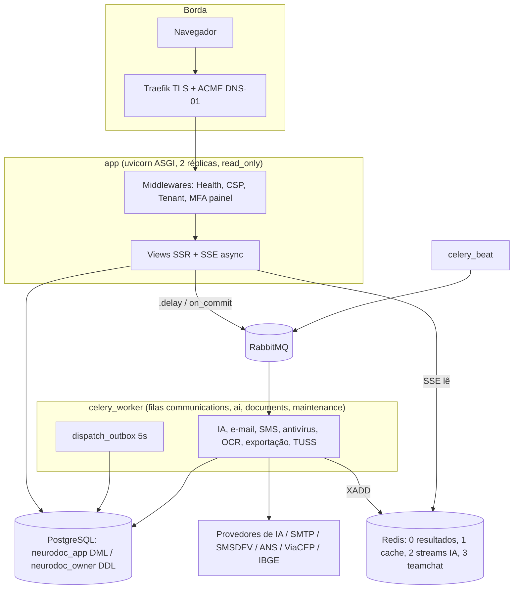
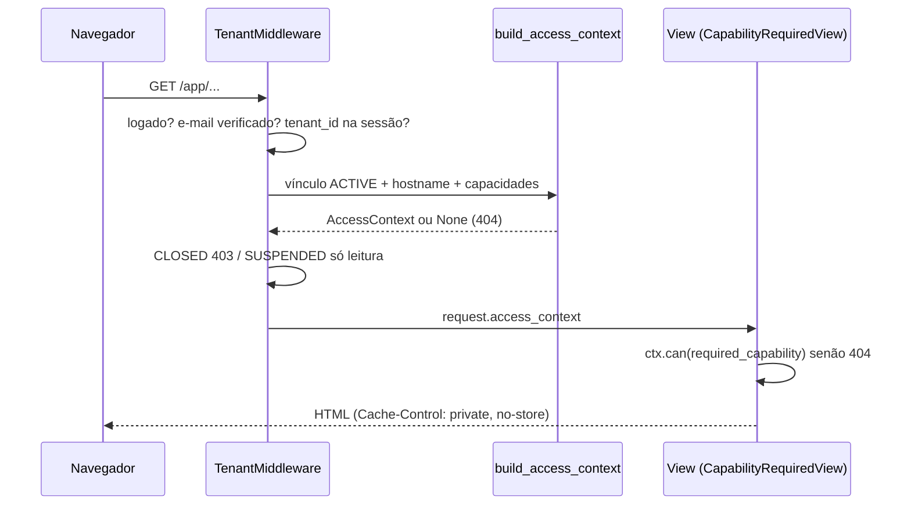
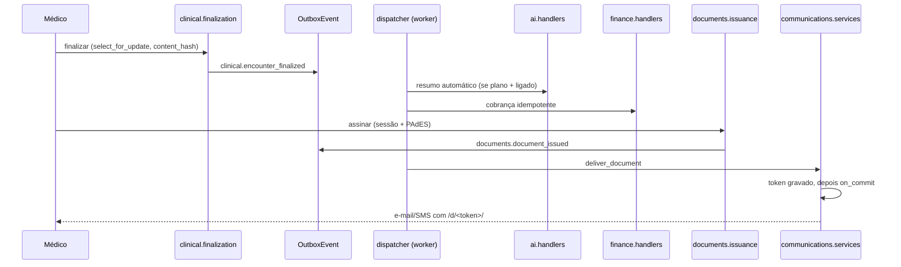
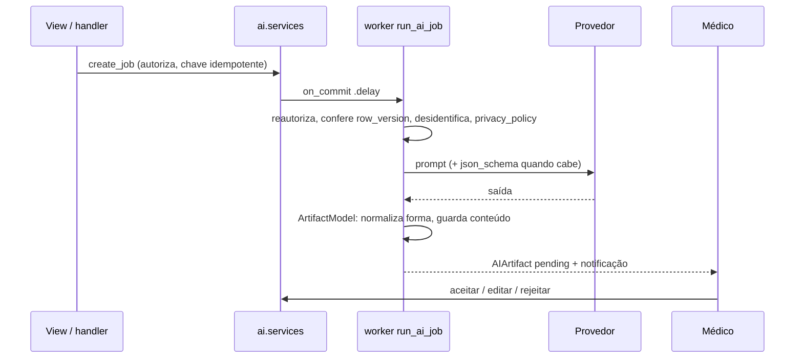

# Mapa do código

> Gerado pela skill Cartographer em 2026-10-18 (versão 1.15, commit `390e3dd`).
> Onze leitores em paralelo, cada um com um pedaço do repositório; este
> arquivo é a síntese. É **mapa**, não especificação: onde ele e o código
> divergirem, vale o código, e onde divergir de `CLAUDE.md`, vale o
> `CLAUDE.md` até alguém conferir.
>
> Sem links clicáveis para arquivos de código de propósito: `mkdocs build
> --strict` roda dentro do `Dockerfile` e um link relativo para fora de
> `docs/` derrubaria a build da imagem. Os caminhos vão em `código`.

## 1. Visão geral



**Regra que explica metade do código:** quem tem segredo de egresso é o
worker. O `app` não recebe `SMSDEV_API_KEY`, senha SMTP nem chave de IA da
instalação; trabalho externo escrito dentro da requisição não fica lento,
**não funciona** (ver `CLAUDE.md` §2).

## 2. Estrutura de diretórios

```
neurodoc/
├── core/            settings, urls, asgi, celery (configuração única)
├── base/            TenantModel, cripto, CSP, SEO, logging com redação, landing/onboarding, ajuda, versão, comandos de operação
├── accounts/        User (e-mail), MFA TOTP, recuperação, PhysicianProfile, login com limite
├── tenancy/         Tenant, Membership, AccessContext, matriz de permissão, planos, limites, convites, contrato
├── patients/        cadastro, contatos, convênio, numeração, foto, naturalidade, importação XML
├── catalogs/        CID-10, TUSS, CMED, IBGE, CEP (globais, sem inquilino)
├── clinical/        Encounter (estruturado e texto livre), achados, CID, medicação, laudos, adendo, cópia, por CID, série temporal
├── exams/           motor do roteiro em árvore (YAML) e escalas pontuadas
├── scheduling/      grade não materializada, reservas, bloqueios, feriados, retornos, declaração, estatísticas
├── finance/         honorários com vigência, cobrança no check-in, pagamento, ajuste, repasse
├── documents/       anexos (antivírus, OCR), documentos médicos, PAdES, QR, portal, retenção 20 anos
├── communications/  outbox de entrega (e-mail/SMS), link opaco, campanhas, SMTP/SMS da clínica
├── ai/              jobs com revisão médica, chat com SSE, provedores, desidentificação, relatório, leitura de laudo
├── events/          OutboxEvent + despachante com posse por lease
├── audit/           AuditEvent INSERT-only (única porta: record_audit_event)
├── notifications/   sino do usuário
├── teamchat/        chat interno da equipe (Redis Streams + SSE)
├── reporting/       indicadores, exportação do acervo (MD/JSON), CSV seguro
├── integrations/    antivírus (clamscan), CEP, TUSS; modelos legados de captura
├── ops/             deploy, backup/restauração, runtime, health, console /instalacao/, compose local
├── scripts/         deploy.sh, backup.sh, setup_deploy.sh, puxar_backups.ps1, gerar_icones.py
├── checks/          ~110 roteiros de verificação (substituem a suíte de testes, DEC-20)
├── templates/       SSR: base.html, base_auth.html, base_public.html + uma pasta por app
├── static/          duralux (tema, app.js, nd-inline.js), JS por app, brand/, help/
├── docs/            homologação, releases, operações, governança LGPD, decisões
├── design_system/   tema Duralux de referência (assets enormes, não lidos)
├── PRD.md           especificação (~97 mil tokens)
└── docker-stack.yml produção (Swarm); compose.yml é GERADO a partir dele
```

## 3. Guia por módulo

### core
`core/settings.py` lê `.env` e secrets (`ops.env.secret`, que aceita
`NOME_FILE` ou `NOME`, nunca os dois; `DISABLED` conta como ausente).
Celery: broker RabbitMQ, resultados no Redis 0, filas `maintenance`
(padrão), `ai`, `communications`, `documents`; limite 300/360 s; `prefetch`
1. Beat relevante: `dispatch_outbox` 5 s, `retomar_jobs_parados` 600 s,
`expire_exports` 300 s, `purge_expired` de notificações 01:10, antivírus a
cada 6 h, TUSS semanal + retomada horária.

### base
| Arquivo | Papel |
|---|---|
| `base/models.py` | `TimestampedModel` (UUID, `row_version`), `TenantModel` (FK PROTECT + `UNIQUE(tenant, id)`), `InstallationSettings` (singleton: IA padrão, allowlist, ensaio da coleta) |
| `base/db.py` | `composite_tenant_foreign_key` → `RunSQL` com FK `(tenant_id, fk)` DEFERRABLE |
| `base/crypto.py` | envelope Fernet: chave de dados por segredo, embrulhada por `SECRETS_MASTER_KEY` (recua para `PFX_MASTER_KEY`); `rewrap_secret` para rotação |
| `base/csp.py`, `csp_views.py` | nonce por resposta, `CSP_ENFORCE`, coletor `/csp-report/` com teto por IP |
| `base/net.py` | `client_ip` só confia em `X-Forwarded-For` vindo de `TRUSTED_PROXIES` |
| `base/logging.py` | redação de senha/token em log; e-mail de 500 sem POST, query string ou URL com credencial |
| `base/seo.py`, `seo_views.py`, `public_urls.py` | lista de permissão `PAGINAS` → robots, canônica, JSON-LD, sitemap; ícones na raiz |
| `base/views.py`, `urls.py` (`app_name='onboarding'`) | landing, lead, plano grátis, signup com contrato inteiro na tela |
| `base/help_views.py`, `help_content.py`, `content.py` | manual público e texto de venda, versionados em Python |
| `base/context_processors.py` | `shell`: `nd_can`, `nd_section`, sino, não lidas, portal |
| `base/templatetags/nd.py` | filtros `nd_*` (campos, papéis, idade, exame) |
| `base/version.py` | `VERSION = '1.15'`; não importa nada (lido pelo host no deploy) |
| `base/management/commands/` | `bootstrap_release`, `wait_for_*`, `create_superadmin`, `seed_demo`, `rodar_roteiros`, `prepare_recovery`, `rotate_secrets_master_key` |

### accounts
`User` com e-mail em minúsculas e único; `get_full_name` cai em
`PhysicianProfile.professional_name` e depois no e-mail. Login:
`EmailLoginView` (limite 5/15 min por e-mail+IP) → `MFAChallengeView`
(TOTP ou código de recuperação; `django_otp_login` torna `is_verified()`
verdadeiro) → `TenantPickerView` (nunca lembra a escolha entre logins).
`accounts/mfa.py`: `@require_recent_mfa` (30 min por sessão) redireciona
para `mfa-confirm?next=`. Médico pode validar o próprio CRM (consultório
solo); fica registrado `verified_by`.

### tenancy
| Arquivo | Papel |
|---|---|
| `middleware.py` | `TenantMiddleware` em `/app/`: login, e-mail verificado, `tenant_id` na sessão, contexto ou 404, `CLOSED` 403, `SUSPENDED` recusa verbo não seguro (exceto `/app/notifications/`, `/app/mensagens/lida/`); `Cache-Control: private, no-store` padrão |
| `context.py` | `AccessContext` frozen, refeito do banco a cada requisição; confere hostname contra `TenantDomain` |
| `permissions.py` | 13 `Capability`; `capabilities_for(roles, *, clinically_enabled, ai_contracted)` sem default; `CapabilityRequiredView` recusa com **404**; `can_configure_agenda_of`, `can_set_fee_for` |
| `plans.py`, `limits.py` | catálogo em centavos, `None` = ilimitado; contagem de paciente ativo completo e médico ativo; override vence plano (`is None`, porque 0 vale) |
| `invitations.py`, `services.py` | token só como SHA-256; aceite de plataforma atômico (convite → User → Tenant → Membership owner → ContractAcceptance → roteiro de exame) |
| `contract.py`, `contracts.py` | texto versionado (`VERSAO`), SHA-256, cópia integral, prazos gravados no registro |
| `admin_views.py` | `/app/org/...`; rota genérica `<str:action>` declarada por último |
| `branding.py` | logotipo PNG/JPEG/WebP por bytes (`magic`), sem SVG; `logo_etag` carrega o inquilino |

### patients
Três caminhos de criação: `PatientCreateView` (completo, transação com
limite repetido e foto por último), `scheduling.services.quick_register_patient`
(pré-cadastro) e `import_pacientes_xml` (`update_or_create` por
`legacy_id`, sem `full_clean`). Por isso o nome é normalizado em
`Patient.save()` também, não só no `clean()`. `numbering.py`: contador
`select_for_update` que nunca volta. `photo.py` fica fora de
`documents.storage` de propósito. `selectors._filtro_de_busca` só compara
CPF/telefone quando a busca tem dígitos.

### catalogs
Globais (`TimestampedModel`, sem inquilino). Toda carga cria
`CatalogRelease` nova; `activate_release` aposenta as anteriores, nunca
reescreve (há snapshot clínico apontando). `search_text` sem acento porque
o banco não tem `unaccent`; `normalize_for_search` é usada na gravação e na
busca. CID-10 sobe sozinho (`ensure_cid10` no `prepare_release`); CMED e
IBGE são manuais no worker; TUSS é cadeia retomável (~80 s por página da
ANS). A tarja da CMED só **avisa**, não decide o receituário.

### clinical
- `Encounter` em dois `kind` (`structured` com abas, `free_text` sem);
  `draft` → `in_progress` (primeiro autosave) → `finalized`.
- `finalization.py`: `select_for_update`, `missing_requirements` com aba e
  âncora, grava só os campos da finalização, `content_hash` (11 campos de
  texto — **não** cobre achados, medicação, CID, adendo nem laudo),
  auditoria e `OutboxEvent clinical.encounter_finalized`.
- Imutabilidade do finalizado é **de aplicação** (`is_editable()`), sem
  trigger. Correção só por `ClinicalAmendment`.
- Autosave: `row_version` obrigatório, 409 em divergência; achados,
  medicação e CID são last-write-wins.
- `carry_forward.py`: copia conduta, impressões, medicação em uso e
  diagnósticos como `CarryForwardItem` **pendentes**; pendente bloqueia a
  finalização.
- `por_cid.py`: vale a **última palavra** por paciente e código.
- `series.py`: SVG no servidor, eixo X proporcional à data.
- `views.TenantScopedView`: GET exige `READ_CLINICAL`, qualquer outro verbo
  `WRITE_CLINICAL` — view nova não nasce aberta.
- FK composta aplicada em `clinical/migrations/0009_*`.

### exams
YAML (`exams/data/neurologia.yaml`, `escalas.yaml`) → `ExamTemplate` /
`ExamNode` por inquilino, versionado (reinstalar cria versão nova). O
identificador do achado é o `path` do nó, não o id. Campo de formulário
`no__<path>__<lado>`; `recording.save_axis` grava um eixo inteiro, apaga
linha em branco. "Tudo normal" marca `value_json={'bulk': True}` e nunca
sobrescreve registro manual. `scoring.score`: escala incompleta é total
parcial sem faixa. Atenção: a tela mostra sempre o roteiro **atual**; item
que mudou de `path` fica órfão.

### scheduling
- Grade **não materializada** (`availability.py`). Ordem dos recortes:
  regra semanal → menos `RecurringBreak` → mais `extra_availability` →
  menos bloqueios de data (`block`, `vacation`, `holiday`,
  `removed_slot`); reserva só marca `busy`. `open_intervals` é o único
  lugar que subtrai.
- `Appointment.occupied_range` + `ExclusionConstraint` no Postgres por
  médico (encaixe escapa com motivo). `_lock_days` usa advisory lock por
  médico+dia.
- Transições: `SCHEDULED`/`CONFIRMED` → `CHECKED_IN` → `IN_PROGRESS` →
  `COMPLETED`; saídas `CANCELLED`, `NO_SHOW` (só após o fim).
- Eventos: `appointment_reserved|rescheduled|cancelled` e lembretes
  `.24h`/`.2h` com `event_version = row_version`.
- `returns.py` (aviso 20 dias antes, `due_on <= hoje+20` recupera dia
  perdido), `declaracao.py` (sem CID), `estatisticas.py` (mesma grade da
  agenda).
- Rota genérica `<uuid>/<action>/` vem **depois** das específicas.

### finance
`pricing.resolve_price`: médico > plano > procedimento; tipo de consulta só
desempata. Sobreposição de vigência barrada em aplicação com advisory lock
(EXCLUDE não pega NULL = NULL). Cobrança nasce no **check-in**, na mesma
transação (por isso o tipo trava ali), e também pelo handler de
`encounter_finalized`; os dois convergem por idempotência. Sem tabela
aplicável, devolve `None` e deixa `finance.receivable_pricing_missing` na
trilha.

### documents
- `Attachment`: quarentena → `scan_attachment` (clamscan no worker) →
  `published/`; antivírus indisponível **mantém** em quarentena.
- `MedicalDocument`: `draft` → `ready_to_sign` → `signing` → `issued`
  (ou `issued_on_paper`, sem QR). `validation_token` nasce no rascunho
  porque o QR vai dentro do PDF antes de assinar.
- `issuance.sign_and_issue`: número sob trava, re-renderiza sem a tarja de
  rascunho, PAdES incremental (pyHanko), `OutboxEvent
  documents.document_issued`; falha de assinatura auditada **depois** do
  rollback.
- `signing_sessions.py`: MFA recente, senha do PFX cifrada com chave
  efêmera em tmpfs (`/run/neurodoc-signing`), amarrada ao navegador.
- `retention.py`: 20 anos do último registro; coleta e compactação
  recusam rodar durante o backup (advisory lock `ops.locks.BACKUP_LOCK`).
- Públicas: `/verificar/` (paciente mascarado, falha aberta no limitador),
  `/solicitacoes/<slug>/` (CPF+nascimento, resposta idêntica para acerto e
  erro, `portal_retorno` em três portas).

### communications
- `services._send` é o ponto único: posse por `UPDATE pending→sending`,
  falha inesperada vira `failed` e **nunca** propaga.
- `deliver_document`: transação por entrega, mensagem **depois** do commit
  do token; reenvio revoga os links anteriores uma vez, antes do laço.
- Cadeia do remetente: médico → clínica → instalação (`resolve_sender`);
  o SMTP é independente do remetente. `clinic_own_server` é a única
  definição de "servidor próprio" (campanha só sai por ele).
- `smsdev.resolve_api_key` confere o plano antes da chave.
- `mail_backend.WorkerEmailBackend` serializa e enfileira com `on_commit`,
  recusa anexo.
- Link `/d/<token>/`: 32 bytes, guarda só o hash, 30 dias, 5 tentativas;
  desafio = 4 últimos dígitos do CPF ou data de nascimento.
- `handlers.JANELA_DO_AVISO = 6h` medida por `created_at`.

### ai
- `AIJob` → `AIArtifact` (`review_state=pending`) → `review.accept|edit|reject`.
- `build_ai_authorization` relida na criação, no worker, no handler e no
  chat/SSE.
- Idempotência `kind:alvo:versão`.
- Desidentificação local antes de qualquer envio; `privacy_policy` falha
  fechada.
- Provedor: o da clínica se `is_usable`, senão o da instalação (console);
  nunca há recuo silencioso entre provedores.
- 4xx (exceto 408/429) = "repetir não resolve".
- `schemas.ArtifactModel` normaliza **forma**, validadores guardam
  **conteúdo**.
- Chat: só ids vão ao broker; o worker publica deltas em Redis Stream (DB
  2, TTL 1 h), o SSE async lê a cada 0,5 s e reconfere `CLINICAL_AI` a
  cada volta.

### events, audit, notifications, teamchat
- **`events/dispatcher.py`:**
  - lotes de 50 com `skip_locked`;
  - `locked_until` é o token de posse;
  - consumidor fora de transação externa;
  - backoff `min(2**n, 900)` e `MAX_ATTEMPTS=8`;
  - sem handler devolve a tentativa;
  - consumidores registrados em `AppConfig.ready()` (`ai`, `communications`, `scheduling`, `finance`).
- **`audit`:** trilha INSERT-only (trigger + `REVOKE UPDATE, DELETE`, migration `audit/0003`); só ids e contagens, nunca texto clínico; IP truncado.
- **`notifications`:** destino resolvido na leitura (`targets.REGISTRY`); `notify_capability` calcula a capacidade igual à tela; purga em 7 dias (lida) e 15 dias (não lida).
- **`teamchat`:**
  - `services.py` é o único escritor (contador denormalizado);
  - SSE com aba líder (`localStorage`) + `BroadcastChannel`;
  - reautoriza o vínculo a cada 10 s.

### reporting
- **Registro e autorização:**
  - relatórios registrados em `reporting/apps.py` com a capacidade por relatório;
  - `request_export` confere a capacidade, não a view.
- **Acervo (sempre no worker):**
  - `acervo_pacientes` exige `MANAGE_ORGANIZATION`;
  - `acervo_atendimentos` exige `MANAGE_ORGANIZATION` **e** `READ_CLINICAL`.
- **Arquivo gerado:**
  - permissão 0600 com `O_EXCL`;
  - expira em 24 h, conferido no próprio download.
- **Exportadores:**
  - CSV com prefixo `'` contra injeção de fórmula;
  - JSON sem sanitizar;
  - `suppress_small_cells` agrega contagens abaixo de 5.

### ops e scripts
- **Deploy.** `scripts/deploy.sh` (flock em `.runtime/operation.lock`) → `ops/deploy.py`:
  - preflight estrito (`DEBUG=False`, release aprovada, redes, secrets, tmpfs de assinatura, hashes no `requirements.txt`);
  - `git pull --ff-only` e reexecução;
  - build/push por SHA;
  - `docker stack deploy`;
  - `wait_for_stack`;
  - GET em `/health/`.
- **Migração na subida.** `ops/entrypoint.sh app` → `bootstrap_release` → `ops/runtime.prepare_release`:
  - advisory lock 72654001;
  - `migrate --database=migrations`;
  - `collectstatic` atômico em `/static/<RELEASE_ID>/`;
  - `ensure_cid10`.
- **Backup.** `ops/backup.py`:
  - `pg_dump | age`, tars dos volumes e `manifest.json` com sha256;
  - trava compartilhada com a coleta de documentos;
  - retenção mínima de 7 dias.
- **Restauração.** `ops/restore.py` (`--prepare-data` / `--activate`, em modo de recuperação) refaz o `REVOKE` da auditoria que o `--no-acl` perde.
- **Console.** `ops/superadmin.py`: `/instalacao/`, superusuário com MFA ou 404, sem conteúdo clínico.

## 4. Fluxos principais

### Requisição em `/app/`



### Do atendimento finalizado ao paciente



### Job de IA



## 5. Convenções

- **Tudo que o usuário lê** está em português, inclusive erro (`check_idioma`).
- **Comentário explica por quê**, citando o incidente: data, auditoria (ND-1121-xxx), alternativa recusada.
- **Autorização:**
  - por capacidade (`ctx.can(...)`), nunca por papel;
  - recusa é 404;
  - `required_capability = None` só por decisão explícita.
- **Isolamento entre inquilinos:**
  - todo modelo de domínio herda `TenantModel`;
  - consultas passam por `scope_to_tenant`.
- **Dinheiro em centavos ou `Decimal`**; `None` = ilimitado.
- **Hoje = `timezone.localdate()`**, nunca `date.today()` (`check_fuso`).
- **Trabalho externo sai pelo worker**, enfileirado com `on_commit`.
- **Front-end sem `onclick`:**
  - comportamentos em `static/duralux/nd-inline.js` e `app.js` via `data-nd-*`;
  - `<script>` inline leva `nonce="{{ nd_csp_nonce }}"`.
- **Escrita com trilha:** `@transaction.atomic` + `record_audit_event`, que guarda ids e contagens, nunca texto clínico.
- **Efeito colateral nunca derruba o ato principal:** entrega e aviso que falham viram linha marcada.

## 6. Pegadinhas

- **Imutabilidade e trilha:**
  - imutabilidade do prontuário finalizado é só de aplicação; a da trilha de auditoria tem trigger;
  - `content_hash` não sela achados, medicação, CID, adendo nem laudo.
- **Isolamento:**
  - FK composta só em `clinical` e `teamchat`; nos outros apps o isolamento é o filtro por inquilino;
  - `LabValue.exam_result` é CASCADE, ao contrário do resto (PROTECT).
- **Agenda:**
  - `RecurringBreak` não é `ScheduleBlock`;
  - `REMOVED_SLOT` some da grade; `BLOCK` com o motivo da agenda continua e conta na estatística.
- **Comportamento em falha:**
  - o limitador de `/verificar/` **falha aberto** (a farmácia continua conferindo);
  - os do portal, do link de entrega e do plano grátis **falham fechados**.
- **`.env` × console:**
  - o `.env` só semeia `InstallationSettings`; depois quem manda é o console `/instalacao/operacao/`;
  - roteiro com `override_settings(AI_PROVIDER=...)` mede um caminho que o produto não percorre.
- **Roteiros (`checks/`):**
  - `rodar_roteiros` lê de dentro da imagem: sem `--build`, a bateria testa código velho e passa. Para iterar: `manage.py shell < checks/check_x.py`;
  - `check_instalacao` exige banco vazio; o resto exige `seed_demo` (+ `import_cmed` para receitas);
  - `check_roles` e `check_tenantb` só imprimem, nunca falham;
  - `check_chat_stream_ui.cjs` é Node e o runner ignora.
- **Infraestrutura:**
  - `docker stack deploy` ignora em silêncio a chave curta `tmpfs:`; o `/tmp` é declarado na forma longa;
  - `compose.yml` é gerado: edite `docker-stack.yml` e rode `python -m ops.local_compose`.
- **Documentação:**
  - `mkdocs build --strict` roda na build da imagem; link quebrado em `docs/` derruba o deploy;
  - divergências que os leitores acharam, **corrigidas em 2026-10-18**: a P-10 no `decisions.md` (agora "resolvida"), o DEC-21 repetido (a decisão do CEP virou DEC-54), a P-02 no `docs/operations/environment.md`, a tabela incompleta do `checks/README.md` (agora com os 108 roteiros) e o docstring de `ops/superadmin.py`, que dizia "duas escritas" quando já eram seis.
- **Pendências e incertezas:**
  - `ops/deploy.py` ainda tem `DEFAULT_REGISTRY = 'ghcr.io/pycodebr/scsi_v1'`, herdado de outro projeto e usado só quando `REGISTRY` falta no `.env`. Não foi alterado (é código);
  - ~~`LICENSE` diz MIT e o contrato (cláusula 16) diz o contrário~~ — resolvida em 2026-10-19: repositório público sob MIT e contrato 1.1 com o item 16.3.

## 7. Onde mexer

| Para… | Arquivos |
|---|---|
| **Nova tela em `/app/`** | view herdando `CapabilityRequiredView` com `required_capability`, rota no `urls.py` do app (genéricas por último), template estendendo `base.html`, item no `partials/sidebar.html` com `nd_can` |
| **Nova capacidade ou mudança de papel** | `tenancy/permissions.py`; rodar `check_matrix`, `check_roles`, `check_secretary` |
| **Preço, limite ou plano** | `tenancy/plans.py`; obrigatórios `check_landing` e `check_planos` |
| **Campo no prontuário** | `clinical/models.py` + migration expand-only, `forms.EncounterForm.Meta.fields` (autosave), template da aba, decidir se entra em `compute_content_hash`; `check_estruturado` / `check_texto_livre` |
| **Item do exame neurológico** | `exams/data/neurologia.yaml` + `install_exam_template` (cria versão nova); `check_roteiro` |
| **Novo tipo de documento médico** | `documents/pdf/<tipo>.py`, `document_kinds.py`, `MedicalDocument.kind`; `check_docform`, `check_rodape_do_documento` |
| **Nova mensagem ao paciente** | produtor grava `OutboxEvent`, handler em `communications/handlers.py` registrado no `apps.py`, envio por `services._send` (nunca na view; `check_provedor_e_sms` varre) |
| **Novo consumidor de evento** | `register_handler` no `AppConfig.ready()`; idempotente por chave própria; conferir a idade do evento (`created_at`) |
| **Nova tarefa de IA** | `ai/graphs.TASKS` + esquema herdando `ArtifactModel` + prompt que declara o tipo de cada campo; `check_leitura_laudo` |
| **Configuração que vira sem deploy** | `base.models.InstallationSettings` + tela em `ops/superadmin.py` |
| **Página pública indexável** | `base/seo.PAGINAS`; `check_seo` |
| **Variável de ambiente nova** | `.env.example`, `ops/make_runtime.py` (`COMMON_KEYS` ou `OPTIONAL_KEYS`), `ops/local_compose.py` |
| **Mudança de agenda** | `scheduling/availability.py` (recortes) e `services.py` (escrita com lock); `check_agenda`, `check_mes_e_estatisticas`, `check_incluir_horario`, `check_excluir_horario`, `check_bloquear_horario` |
| **Deploy, backup ou restauração** | `ops/deploy.py`, `ops/backup.py`, `ops/restore.py`; `docs/operations/` |
