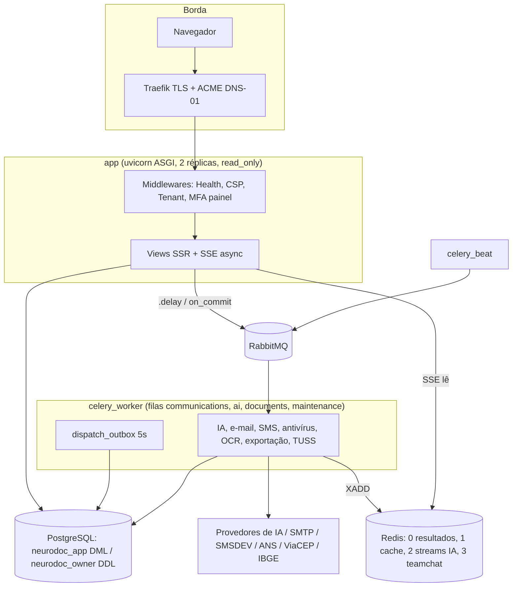
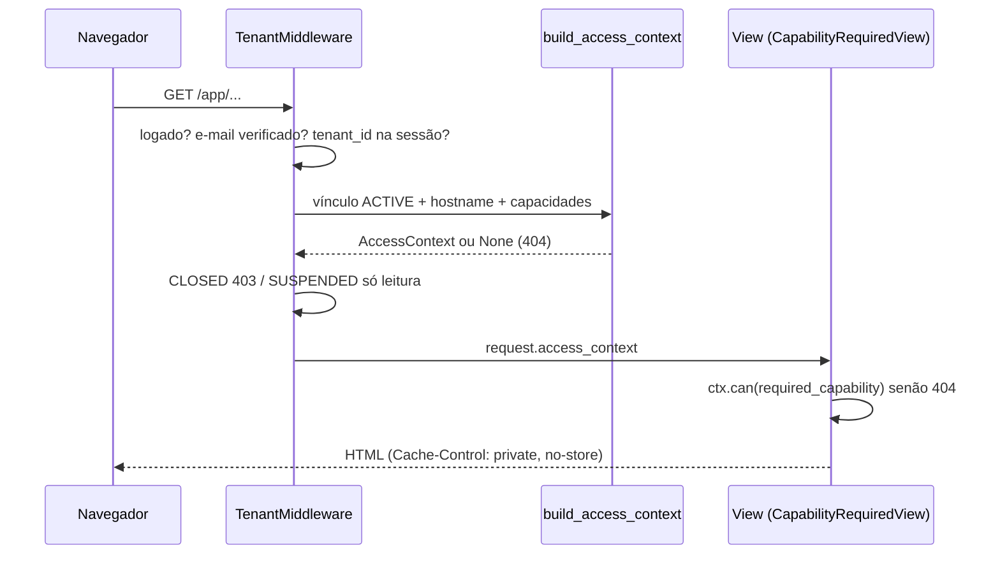
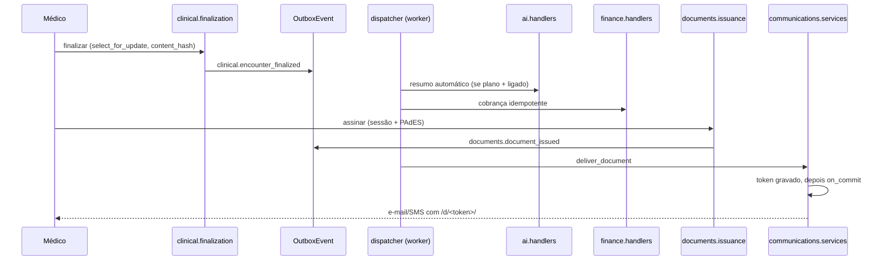
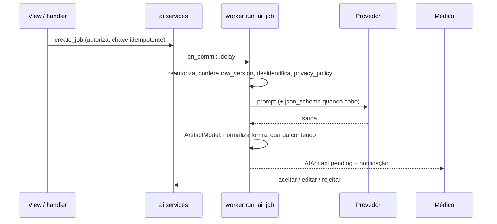

# Mapa do código

> Gerado pela skill Cartographer em 2026-10-18 (versão 1.15, commit `390e3dd`);
> atualizado em 2026-10-24 (versão 1.24.2, commit `ee45d07`) só nos módulos
> que mudaram — o app `sncr`, a reserva de IA, o laudo pelo portal, a
> Portaria 344, a retenção do chat da equipe e a idempotência da entrega;
> e de novo em 2026-11-02 (versões 1.32.1 e 1.32.2, revisão do código), também só no
> que mudou: os apps `tiss` e `agenda_exames`, o SNCR em produção, a lista
> de espera e a forma de cobrança, as finanças do exame, a migração do
> iClin, o e-mail descartável, as operadoras da ANS, os preços, o CPF e o
> encerramento. Três leitores nessa rodada. Acréscimos à mão em 2026-11-03:
> os processos do `app` e do worker por instalação (seção `ops e scripts`) e
> a Notificação de Receita A, B e B2 (1.34, seção "sncr — Notificação de
> Receita").
> Onze leitores em paralelo, cada um com um pedaço do repositório; este
> arquivo é a síntese. É **mapa**, não especificação: onde ele e o código
> divergirem, vale o código, e onde divergir de `CLAUDE.md`, vale o
> `CLAUDE.md` até alguém conferir.
>
> Sem links clicáveis para arquivos de código de propósito: `mkdocs build
> --strict` roda dentro do `Dockerfile` e um link relativo para fora de
> `docs/` derrubaria a build da imagem. Os caminhos vão em `código`.

## 1. Visão geral



**Regra que explica metade do código:** quem tem segredo de egresso é o
worker. O `app` não recebe `SMSDEV_API_KEY`, senha SMTP nem chave de IA da
instalação; trabalho externo escrito dentro da requisição não fica lento,
**não funciona** (ver `CLAUDE.md` §2).

## 2. Estrutura de diretórios

```
neurodoc/
├── core/            settings, urls, asgi, celery (configuração única)
├── base/            TenantModel, cripto, CSP, SEO, logging com redação, landing/onboarding, ajuda, versão, comandos de operação
├── accounts/        User (e-mail), MFA TOTP, recuperação, PhysicianProfile, login com limite
├── tenancy/         Tenant, Membership, AccessContext, matriz de permissão, planos, limites, convites, contrato
├── patients/        cadastro, contatos, convênio, numeração, foto, naturalidade, importação XML
├── catalogs/        CID-10, TUSS, CMED, IBGE, CEP (globais, sem inquilino)
├── clinical/        Encounter (estruturado e texto livre), achados, CID, medicação, laudos, adendo, cópia, por CID, série temporal
├── exams/           motor do roteiro em árvore (YAML) e escalas pontuadas
├── scheduling/      grade não materializada, reservas, bloqueios, feriados, retornos, declaração, estatísticas
├── finance/         honorários com vigência, cobrança no check-in, pagamento, ajuste, repasse
├── documents/       anexos (antivírus, OCR), documentos médicos, PAdES, QR, portal, retenção 20 anos
├── communications/  outbox de entrega (e-mail/SMS), link opaco, campanhas, SMTP/SMS da clínica
├── ai/              jobs com revisão médica, chat com SSE (com o manual do sistema, sem paciente), provedores, desidentificação, relatório
├── events/          OutboxEvent + despachante com posse por lease
├── audit/           AuditEvent INSERT-only (única porta: record_audit_event)
├── notifications/   sino do usuário
├── teamchat/        chat interno da equipe (Redis Streams + SSE)
├── reporting/       indicadores, exportação do acervo (MD/JSON), CSV seguro
├── integrations/    antivírus (clamscan), CEP, TUSS; modelos legados de captura
├── ops/             deploy, backup/restauração, runtime, health, console /instalacao/, compose local
├── scripts/         deploy.sh, backup.sh, setup_deploy.sh, puxar_backups.ps1, gerar_icones.py
├── checks/          ~110 roteiros de verificação (substituem a suíte de testes, DEC-20)
├── templates/       SSR: base.html, base_auth.html, base_public.html + uma pasta por app
├── static/          duralux (tema, app.js, nd-inline.js), JS por app, brand/, help/
├── docs/            homologação, releases, operações, governança LGPD, decisões
├── design_system/   tema Duralux de referência (assets enormes, não lidos)
├── PRD.md           especificação (~97 mil tokens)
└── docker-stack.yml produção (Swarm); compose.yml é GERADO a partir dele
```

## 3. Guia por módulo

### core
`core/settings.py` lê `.env` e secrets (`ops.env.secret`, que aceita
`NOME_FILE` ou `NOME`, nunca os dois; `DISABLED` conta como ausente).
Celery: broker RabbitMQ, resultados no Redis 0, filas `maintenance`
(padrão), `ai`, `communications`, `documents`; limite 300/360 s; `prefetch`
1. Beat relevante: `dispatch_outbox` 5 s, `retomar_jobs_parados` 600 s,
`expire_exports` 300 s, `purge_expired` de notificações 01:10, antivírus a
cada 6 h, TUSS semanal + retomada horária.

### base
| Arquivo | Papel |
|---|---|
| `base/models.py` | `TimestampedModel` (UUID, `row_version`), `TenantModel` (FK PROTECT + `UNIQUE(tenant, id)`), `InstallationSettings` (singleton: IA padrão, allowlist, ensaio da coleta) |
| `base/db.py` | `composite_tenant_foreign_key` → `RunSQL` com FK `(tenant_id, fk)` DEFERRABLE |
| `base/crypto.py` | envelope Fernet: chave de dados por segredo, embrulhada por `SECRETS_MASTER_KEY` (recua para `PFX_MASTER_KEY`); `rewrap_secret` para rotação |
| `base/csp.py`, `csp_views.py` | nonce por resposta, `CSP_ENFORCE`, coletor `/csp-report/` com teto por IP |
| `base/net.py` | `client_ip` só confia em `X-Forwarded-For` vindo de `TRUSTED_PROXIES` |
| `base/logging.py` | redação de senha/token em log; e-mail de 500 sem POST, query string ou URL com credencial |
| `base/seo.py`, `seo_views.py`, `public_urls.py` | lista de permissão `PAGINAS` → robots, canônica, JSON-LD, sitemap; ícones na raiz |
| `base/views.py`, `urls.py` (`app_name='onboarding'`) | landing, lead, plano grátis, signup com contrato inteiro na tela |
| `base/help_views.py`, `help_content.py`, `content.py` | manual público e texto de venda, versionados em Python |
| `base/context_processors.py` | `shell`: `nd_can`, `nd_section`, sino, não lidas, portal |
| `base/templatetags/nd.py` | filtros `nd_*` (campos, papéis, idade, exame) |
| `base/version.py` | `VERSION = '1.15'`; não importa nada (lido pelo host no deploy) |
| `base/management/commands/` | `bootstrap_release`, `wait_for_*`, `create_superadmin`, `seed_demo`, `rodar_roteiros`, `prepare_recovery`, `rotate_secrets_master_key` |

### accounts
`User` com e-mail em minúsculas e único; `get_full_name` cai em
`PhysicianProfile.professional_name` e depois no e-mail. Login:
`EmailLoginView` (limite 5/15 min por e-mail+IP) → `MFAChallengeView`
(TOTP ou código de recuperação; `django_otp_login` torna `is_verified()`
verdadeiro) → `TenantPickerView` (nunca lembra a escolha entre logins).
`accounts/mfa.py`: `@require_recent_mfa` (30 min por sessão) redireciona
para `mfa-confirm?next=`. Médico pode validar o próprio CRM (consultório
solo); fica registrado `verified_by`.

### tenancy
| Arquivo | Papel |
|---|---|
| `middleware.py` | `TenantMiddleware` em `/app/`: login, e-mail verificado, `tenant_id` na sessão, contexto ou 404, `CLOSED` 403, `SUSPENDED` recusa verbo não seguro (exceto `/app/notifications/`, `/app/mensagens/lida/`); `Cache-Control: private, no-store` padrão |
| `context.py` | `AccessContext` frozen, refeito do banco a cada requisição; confere hostname contra `TenantDomain` |
| `permissions.py` | 13 `Capability`; `capabilities_for(roles, *, clinically_enabled, ai_contracted)` sem default; `CapabilityRequiredView` recusa com **404**; `can_configure_agenda_of`, `can_set_fee_for` |
| `plans.py`, `limits.py` | catálogo em centavos, `None` = ilimitado; contagem de paciente ativo completo e médico ativo; override vence plano (`is None`, porque 0 vale) |
| `invitations.py`, `services.py` | token só como SHA-256; aceite de plataforma atômico (convite → User → Tenant → Membership owner → ContractAcceptance → roteiro de exame) |
| `contract.py`, `contracts.py` | texto versionado (`VERSAO`), SHA-256, cópia integral, prazos gravados no registro |
| `admin_views.py` | `/app/org/...`; rota genérica `<str:action>` declarada por último |
| `branding.py` | logotipo PNG/JPEG/WebP por bytes (`magic`), sem SVG; `logo_etag` carrega o inquilino |

### patients
Três caminhos de criação: `PatientCreateView` (completo, transação com
limite repetido e foto por último), `scheduling.services.quick_register_patient`
(pré-cadastro) e `import_pacientes_xml` (`update_or_create` por
`legacy_id`, sem `full_clean`). Por isso o nome é normalizado em
`Patient.save()` também, não só no `clean()`. `numbering.py`: contador
`select_for_update` que nunca volta. `photo.py` fica fora de
`documents.storage` de propósito. `selectors._filtro_de_busca` só compara
CPF/telefone quando a busca tem dígitos.

### catalogs
Globais (`TimestampedModel`, sem inquilino). Toda carga cria
`CatalogRelease` nova; `activate_release` aposenta as anteriores, nunca
reescreve (há snapshot clínico apontando). `search_text` sem acento porque
o banco não tem `unaccent`; `normalize_for_search` é usada na gravação e na
busca. CID-10 sobe sozinho (`ensure_cid10` no `prepare_release`); CMED e
IBGE são manuais no worker; TUSS é cadeia retomável (~80 s por página da
ANS). A tarja da CMED só **avisa**, não decide o receituário.

### clinical
- `Encounter` em dois `kind` (`structured` com abas, `free_text` sem);
  `draft` → `in_progress` (primeiro autosave) → `finalized`.
- `finalization.py`: `select_for_update`, `missing_requirements` com aba e
  âncora, grava só os campos da finalização, `content_hash` (11 campos de
  texto — **não** cobre achados, medicação, CID, adendo nem laudo),
  auditoria e `OutboxEvent clinical.encounter_finalized`.
- Imutabilidade do finalizado é **de aplicação** (`is_editable()`), sem
  trigger. Correção só por `ClinicalAmendment`.
- Autosave: `row_version` obrigatório, 409 em divergência; achados,
  medicação e CID são last-write-wins.
- `carry_forward.py`: copia conduta, impressões, medicação em uso e
  diagnósticos como `CarryForwardItem` **pendentes**; pendente bloqueia a
  finalização.
- `por_cid.py`: vale a **última palavra** por paciente e código.
- `series.py`: SVG no servidor, eixo X proporcional à data.
- `views.TenantScopedView`: GET exige `READ_CLINICAL`, qualquer outro verbo
  `WRITE_CLINICAL` — view nova não nasce aberta.
- FK composta aplicada em `clinical/migrations/0009_*`.

### exams
YAML (`exams/data/neurologia.yaml`, `escalas.yaml`) → `ExamTemplate` /
`ExamNode` por inquilino, versionado (reinstalar cria versão nova). O
identificador do achado é o `path` do nó, não o id. Campo de formulário
`no__<path>__<lado>`; `recording.save_axis` grava um eixo inteiro, apaga
linha em branco. "Tudo normal" marca `value_json={'bulk': True}` e nunca
sobrescreve registro manual. `scoring.score`: escala incompleta é total
parcial sem faixa. Atenção: a tela mostra sempre o roteiro **atual**; item
que mudou de `path` fica órfão.

### scheduling
- Grade **não materializada** (`availability.py`). Ordem dos recortes:
  regra semanal → menos `RecurringBreak` → mais `extra_availability` →
  menos bloqueios de data (`block`, `vacation`, `holiday`,
  `removed_slot`); reserva só marca `busy`. `open_intervals` é o único
  lugar que subtrai.
- `Appointment.occupied_range` + `ExclusionConstraint` no Postgres por
  médico (encaixe escapa com motivo). `_lock_days` usa advisory lock por
  médico+dia.
- Transições: `SCHEDULED`/`CONFIRMED` → `CHECKED_IN` → `IN_PROGRESS` →
  `COMPLETED`; saídas `CANCELLED`, `NO_SHOW` (só após o fim).
- Eventos: `appointment_reserved|rescheduled|cancelled` e lembretes
  `.24h`/`.2h` com `event_version = row_version`.
- `returns.py` (aviso 20 dias antes, `due_on <= hoje+20` recupera dia
  perdido), `declaracao.py` (sem CID), `estatisticas.py` (mesma grade da
  agenda).
- Rota genérica `<uuid>/<action>/` vem **depois** das específicas.

### finance
`pricing.resolve_price`: médico > plano > procedimento; tipo de consulta só
desempata. Sobreposição de vigência barrada em aplicação com advisory lock
(EXCLUDE não pega NULL = NULL). Cobrança nasce no **check-in**, na mesma
transação (por isso o tipo trava ali), e também pelo handler de
`encounter_finalized`; os dois convergem por idempotência. Sem tabela
aplicável, devolve `None` e deixa `finance.receivable_pricing_missing` na
trilha.

### documents
- `Attachment`: quarentena → `scan_attachment` (clamscan no worker) →
  `published/`; antivírus indisponível **mantém** em quarentena.
- `MedicalDocument`: `draft` → `ready_to_sign` → `signing` → `issued`
  (ou `issued_on_paper`, sem QR). `validation_token` nasce no rascunho
  porque o QR vai dentro do PDF antes de assinar.
- `issuance.sign_and_issue`: número sob trava, re-renderiza sem a tarja de
  rascunho, PAdES incremental (pyHanko), `OutboxEvent
  documents.document_issued`; falha de assinatura auditada **depois** do
  rollback.
- `signing_sessions.py`: MFA recente, senha do PFX cifrada com chave
  efêmera em tmpfs (`/run/neurodoc-signing`), amarrada ao navegador.
- `retention.py`: 20 anos do último registro; coleta e compactação
  recusam rodar durante o backup (advisory lock `ops.locks.BACKUP_LOCK`).
- Públicas: `/verificar/` (paciente mascarado, falha aberta no limitador),
  `/solicitacoes/<slug>/` (CPF+nascimento, resposta idêntica para acerto e
  erro, `portal_retorno` em três portas).

### communications
- `services._send` é o ponto único: posse por `UPDATE pending→sending`,
  falha inesperada vira `failed` e **nunca** propaga.
- `deliver_document`: transação por entrega, mensagem **depois** do commit
  do token; reenvio revoga os links anteriores uma vez, antes do laço.
- Cadeia do remetente: médico → clínica → instalação (`resolve_sender`);
  o SMTP é independente do remetente. `clinic_own_server` é a única
  definição de "servidor próprio" (campanha só sai por ele).
- `smsdev.resolve_api_key` confere o plano antes da chave.
- `mail_backend.WorkerEmailBackend` serializa e enfileira com `on_commit`,
  recusa anexo.
- Link `/d/<token>/`: 32 bytes, guarda só o hash, 30 dias, 5 tentativas;
  desafio = 4 últimos dígitos do CPF ou data de nascimento.
- `handlers.JANELA_DO_AVISO = 6h` medida por `created_at`.

### ai
- `AIJob` → `AIArtifact` (`review_state=pending`) → `review.accept|edit|reject`.
- `build_ai_authorization` relida na criação, no worker, no handler e no
  chat/SSE.
- Idempotência `kind:alvo:versão`.
- Desidentificação local antes de qualquer envio; `privacy_policy` falha
  fechada.
- Provedor: o da clínica se `is_usable`, senão o da instalação (console,
  `InstallationSettings.ia_da_instalacao()`).
- **Reserva da instalação (1.23)** — a única exceção ao "nunca recuar de
  provedor": `providers.reserva_utilizavel`, `installation_reserve_model`,
  `registrar_uso_da_reserva` (`ai.reserva_usada` na trilha, contador `F()`).
  Só para quem usa o padrão, só quando a **chamada falha** (resposta recusada
  pela validação não troca), só ligada no console. No chat, só antes da
  primeira palavra. `tasks.vigiar_ia_da_instalacao` (hora em hora) manda
  e-mail ao superadmin na passagem para falha e a cada 24 h.
- OpenRouter da instalação sai com `ROTEAMENTO_OPENROUTER_DA_INSTALACAO`
  (`zdr`, `data_collection=deny`).
- Leitura de laudo **aposentada** (1.18): `ai/documents.py` e
  `ai/extraction.py` saíram; `models.TIPOS_APOSENTADOS`; a migration `0009`
  cancela o que estava na fila (irreversível); `prepare_document_and_run` é
  stub que cancela.
- `acoes_rapidas.ACOES`: quatro cartões de texto que só preenchem o campo do
  chat com paciente; o servidor não sabe que vieram de cartão.
- `chat_prompt.build_chat_prompt(..., pergunta_id)` tira a pergunta da volta
  do histórico (ia duas vezes ao provedor).
- O relatório do paciente avisa no sino com `target_type='ai_report'` →
  `ai:relatorio-detalhe`.
- 4xx (exceto 408/429) = "repetir não resolve".
- `schemas.ArtifactModel` normaliza **forma**, validadores guardam
  **conteúdo**.
- Chat: só ids vão ao broker; o worker publica deltas em Redis Stream (DB
  2, TTL 1 h), o SSE async lê a cada 0,5 s e reconfere `CLINICAL_AI` a
  cada volta.

### events, audit, notifications, teamchat
- **`events/dispatcher.py`:**
  - lotes de 50 com `skip_locked`;
  - `locked_until` é o token de posse;
  - consumidor fora de transação externa;
  - backoff `min(2**n, 900)` e `MAX_ATTEMPTS=8`;
  - sem handler devolve a tentativa;
  - consumidores registrados em `AppConfig.ready()` (`ai`, `communications`, `scheduling`, `finance`).
- **`audit`:** trilha INSERT-only (trigger + `REVOKE UPDATE, DELETE`, migration `audit/0003`); só ids e contagens, nunca texto clínico; IP truncado.
- **`notifications`:** destino resolvido na leitura (`targets.REGISTRY`); `notify_capability` calcula a capacidade igual à tela; purga em 7 dias (lida) e 15 dias (não lida).
- **`teamchat`:**
  - `services.py` é o único escritor (contador denormalizado);
  - SSE com aba líder (`localStorage`) + `BroadcastChannel`;
  - reautoriza o vínculo a cada 10 s;
  - **esquece**: `RETENCAO_HORAS=72`, `tasks.apagar_vencidas` de hora em hora (refaz o não lido e apaga conversa vazia antiga); "Apagar conversa" grava `ConversationMember.cleared_at` só para quem pediu.

### sncr (novo, 1.21–1.22, desligado por padrão)
- **Modelos** (não herdam `TenantModel`: o bloco é do **médico**,
  `PhysicianProfile`): `Configuracao` (singleton, nasce desligada e em
  homologação, `base_url` vem de `BASES` em código), `PedidoNumeracao`
  (`aguardando_login` → `enviando` → `concluido|recusado|falhou|incerto|expirado`),
  `BlocoNumeracao` (`utilizavel`), `NumeroSncr` (texto, `UNIQUE(ambiente,
  tipo, numero)`). Tudo `PROTECT`.
- `cliente.py` é o único que conhece a API da Anvisa: `Indisponivel` (pode
  repetir), `Incerto` (**nunca** repetir), `Recusado`, `SessaoInvalida`.
- `fluxo.py`: `iniciar` confere tudo antes do login Gov.br (3 pedidos/mês,
  nenhum incerto pendente); `concluir` troca o token (vive 30 s) e pede o
  bloco **na requisição** (exceção deliberada ao §2); o pedido pendente vive
  na sessão Django; `tasks.marcar_pedidos_parados` (5 min) vira incerto o
  que ficou em `enviando`.
- `numeracao.py`: `enumerar` só aceita prefixo + dígitos de mesmo
  comprimento (senão o bloco fica não utilizável, nenhum número é
  inventado); `reservar*` com `skip_locked`, `consumir` só depois de assinado.
- `receita.py` classifica pela Portaria 344 (`catalogs.controlados`), até 3
  medicamentos, **uma folha e um número por medicamento** (I12).
  `pdf_oficial.py` escreve sobre o PDF oficial (`SHA256_MODELO_RCE` —
  trocar o PDF sem a constante derruba a geração).
- Console: `operacao/sncr/` (ligar exige CNPJ, `LIGAR` e motivo; ambiente só
  muda desligado). Menu só com `nd_sncr_ativo`.
- ~~`documents/sncr_transicao.py`~~: substituído na 1.29 por
  `documents/rce_impressa.py` (ver a seção "sncr — o que mudou desde a 1.22"
  abaixo); `MedicalDocumentToPaperView` refaz a eletrônica como impressa sem
  gastar número — só o autor, desde a 1.32.1.

### modelos (novo, 1.28)
- **Modelos de documento**: pedido de exames (`exam_request`, `PEX-`), solicitação
  de cirurgia (`surgery_request`, `CIR-`), relatório e receita (tipos de sempre).
- `estrutura.py`: categorias de exame (fixas em código, a imagem exige
  indicação), tipos, leitura das listas "uma linha por item" com TUSS no começo
  (`ler_exames`, `ler_procedimentos`, `ler_materiais`) e `normalizar`.
- `padrao.py`: os modelos do **sistema**, em código, iguais para todas as clínicas.
- `models.ModeloDocumento`: o modelo do **médico** — liga ao `User`, sem `tenant`
  (segue o médico entre clínicas); nada aponta para ele.
- `servicos.py`: chave única `s:<slug>` / `u:<uuid>` (só do próprio médico) /
  `b:<tipo>` (em branco); `opcoes_para_conduta`.
- `emissao.py`: uma seção por documento (o **conjunto** abre um pedido por
  categoria); `emitir` cria pelo `issuance.create_draft` e emite em papel ou
  marca para assinatura, tudo ou nada; o texto vai para `plan_text` (ou
  `add_amendment` no finalizado), sobe `row_version`, trilha
  `modelos.documentos_emitidos`.
- Na Conduta: `templates/modelos/_na_conduta.html` (estruturado e texto livre),
  com `data-nd-preservar-atendimento`, que `clinical/atendimento.js` usa para
  gravar o texto não salvo antes de sair.

### tiss (novo, 1.30)
Faturamento de convênio TISS (ANS): guia de Consulta e SP/SADT, até o lote
XML. Nasce **desligado** e não fala com operadora. Rotas em `/app/tiss/`;
roteiros `check_tiss_{liberacao,versoes,guias,lotes}`; docs em `docs/tiss/`.
- **Modelos** (todos `TenantModel`, FK composta nas migrações):
  `Configuracao` (singleton, `ativo` nasce `False`); `Prestador` (CNPJ
  alfanumérico, CNES vira `9999999` no snapshot quando vazio);
  `ProfissionalTiss` (`membership` nulo = externo); `Credenciamento`
  prestador × operadora com `versao`, `ciclo`, `limite_guias_por_lote` e
  `exporta_para_cobranca` (versão vigente ou aceite declarado); `Sequencia`
  (`guia`/`lote`, sempre sob `select_for_update`, nunca `MAX+1`); `Guia`
  (`rascunho → fechada → substituida`, ou `cancelada`; `snapshot`, `versao`,
  `data_referencia`, `revisa`; **sem campo de CID**); `ItemGuia`
  (`recebivel` PROTECT, UNIQUE parcial: um recebível em no máximo um item);
  `Lote` (`gerando → pronto | falha | cancelado`; envio e resultado são
  campos, não estados; 1–100 guias por Check); `LoteGuia` (UNIQUE parcial:
  guia em no máximo um lote ativo).
- `guias.py`: `criar_guia`, `criar_guia_do_exame`, `gravar_item`,
  `remover_item`, `pendencias` (`Pendencia(campo, mensagem, impede, quem)`),
  `fechar`, `cancelar`, `abrir_revisao`, `registrar_indicacao`,
  `preco_contratado` (honorário de convênio casado pelo **código** TUSS),
  `conferir_codigo` (vigência na data do serviço). Erro: `GuiaRecusada`.
- `lotes.py`: `elegiveis`, `motivo_de_recusa`, `planejar` (`Plano` com
  `assinatura`), `criar_lotes`, `gerar_arquivo` (worker, idempotente),
  `ler_arquivo` (confere SHA-256), `registrar_envio`/`registrar_resultado`,
  `cancelar_lote`, `liberar_guia`. Erro: `LoteRecusado`.
- `xml.py` escreve `ENVIO_LOTE_GUIAS` **só do snapshot** (`mensagem_lote`,
  `hash_tiss`); `versoes.py` tem as 7 versões (3.04.00 a 4.03.00), confere
  o pacote XSD contra `tiss/xsd/MANIFESTO.json` e valida pelos bytes, sem
  rede nem DTD; `impressao.py` gera o PDF no modelo oficial (do snapshot se
  fechada); `terminologia.py` são rótulos gerados, só para exibição.
- **As três chaves:** plano (`tenancy.plans.has_tiss`) e
  `Tenant.tiss_liberado` viram as capacidades `TISS_*` em
  `tenancy/context.py`; a terceira, `Configuracao.ativo`, é conferida em
  `TissView.dispatch` (404), nas tarefas (`lotes._ainda_autorizado` refaz
  as três no worker) e no menu (`nd_tiss_ativo`). Segundo fator de novo após
  **600 s** sem uso (`tiss_ultimo_uso` na sessão), só nesta área.
- **Financeiro:** a guia **nunca cria** `Receivable`; liga o que existe
  (`ItemGuia.recebivel`). Lote, envio, protocolo e retorno nunca tocam em
  cobrança, pagamento ou ajuste.
- **Fluxo do lote:** fila → seleção → `planejar` (credenciamento × tipo ×
  versão, até `min(limite, 100)`) → confirmação com a `assinatura` do plano
  exibido → `criar_lotes` (trava, número, `on_commit` enfileira) → worker
  grava `.parcial` + `os.replace`, modo 0600, em `MEDIA_ROOT/<tenant>/tiss/`
  → download com SHA-256 conferido → envio e retorno registrados à mão.
- **Pegadinhas:** XML e impressão leem o `snapshot`, nunca o cadastro; a 3.x
  leva nomes que a 4.x não leva e não tem `regimeAtendimento`; exame
  ambulatorial é `05` até a 4.00.01 e `23` depois; letra no CNPJ só na
  4.03.00 (`tiss.validators.cnpj_valido`, não `base.validators`); decimais
  8,2 até a 4.01.00 e 10,2 depois; hash MD5 do texto de todas as tags em
  ISO-8859-1, **não confirmado por operadora real**. Desde 2026-11-02: um
  horário tem no máximo uma guia de Consulta viva (ignora `cancelada` e
  `substituida`), horário ou exame particular não gera guia, cobrança que
  não é de convênio não se vincula, revisão não abre nem fecha com a
  original em lote (`_original_fora_de_lote`), e cancelar a revisão de uma
  original ainda fechada devolve a cobrança a ela.

### agenda_exames (novo, 1.30)
- Agenda **por recurso** (EEG, ENMG, PSG) em `/app/exames/`. **Não é
  `Appointment`**: a agenda médica exige médico e é lida em ~200 pontos; um
  médico fictício consumiria vaga do plano. Entidades paralelas, com a mesma
  garantia de banco.
- Modelos: `Recurso` (`duracao_padrao` 5–1440 min, `intervalo`, TUSS padrão
  em texto); `Janela` (semanal; `fim <= inicio` atravessa a meia-noite);
  `Bloqueio` (só Check de ordem no banco); `Reserva` (instantes, a PSG é uma
  linha só nos dois dias; `ocupacao` = `[inicio, fim + intervalo)` com
  `ExclusionConstraint` por recurso para os estados que ocupam).
- `services.py`: `reservar`, `remarcar`, `mudar_estado`, `definir_cobranca`,
  `criar_bloqueio`, `realizar` → `(reserva, cobranca|None)`,
  `horarios_livres`. Corrida: o banco decide, `IntegrityError` vira
  "horário acabou de ser ocupado".
- Capacidades `EXAMES_AGENDAR` / `EXAMES_CONFIGURAR`, do contrato do TISS,
  **sem** a chave da instalação e sem os 10 minutos. Lembrete na véspera por
  `OutboxEvent` versionado (`versao_lembrete`), entregue por
  `communications.services.deliver_exam_reminder` (`Delivery.reserva_exame`).
- **Pegadinhas:** encaixe fura também o bloqueio; criar bloqueio não cancela
  reserva; mudar `intervalo` não recalcula `ocupacao`; realizar antes do
  `inicio` é recusado; repetir `realizar` devolve a mesma cobrança;
  `Reserva.cobranca` fala `particular`/`convenio` e `Appointment.billing_mode`
  fala `private`/`insurance`; a vigência do convênio é conferida aqui e não
  na consulta.

### finance (1.30 e revisão de 2026-11-02)
- `_active_coverage`: determinística — a ativa da ficha, depois `starts_on`
  mais recente, depois `created_at` (antes era a ordem física do banco).
- `_price_for`: **a escolha do agendamento vence** (`billing_mode`
  `private` ignora o convênio vigente; `insurance` usa o escolhido; vazio é a
  regra antiga). Cobrança criada não se recalcula: o `fee_snapshot` é a
  verdade.
- `create_receivable_for_exam`: terceira origem (`reserva_exame`,
  `ChargeKind.PROCEDURE`, uma por reserva pelo banco), idempotente; sem regra
  aplicável, nada é inventado (`finance.receivable_pricing_missing`).
- `resolve_price_do_procedimento` (2026-11-02): o exame só aceita regra **do
  próprio procedimento**, casada pelo **código** TUSS (a release troca e os
  ids mudam), com `appointment_type=None`; ordem médico+plano, plano, médico,
  geral — a precedência que `resolve_price` já dava às regras com
  procedimento. Antes o exame descia até a regra da consulta.
- `resolve_price`: 7 combinações do mais específico ao mais geral; o tipo de
  atendimento é a dimensão **menos** significativa.

### scheduling — lista de espera e forma de cobrança (1.30–1.31)
- `PacienteEmEspera`: médico nulo = qualquer médico; `posicao` 1..n só entre
  as que aguardam, **sem UNIQUE** (a renumeração violaria no meio do
  `UPDATE`); UNIQUE parcial: um paciente aguardando uma vez.
- `espera.py`: `_travar` (`pg_advisory_xact_lock` por clínica) em toda
  mudança de ordem; `incluir`, `mover_para`, `mover_vizinho` (o vizinho
  **visível** no recorte do médico), `retirar`, `marcar_agendada`,
  `opcoes_do_modal` (até 100).
- Puxar: `QuickBookingView._puxar_da_espera` numa transação só
  (`para_puxar` + `reserve_from_grid` + `marcar_agendada`); qualquer recusa
  desfaz tudo. Sem `espera_id`, o caminho antigo do modal é o de sempre, e
  marcar pela busca não encerra a espera (só avisa).
- `Appointment.billing_mode` + `coverage` (Check no banco), escolhidos no
  painel do modal **até o check-in**; `set_billing_mode` não mexe em
  `row_version`. `change_appointment_patient` **desfaz** a forma de
  cobrança (2026-11-02: o convênio era do paciente anterior e a troca dava
  erro 500).
- `agenda.js`: a caixa "Puxar da lista de espera" é recarregada a cada
  abertura; digitar o nome do pré-cadastro desfaz o paciente escolhido (da
  espera ou da busca); a espera pedida por "Marcar na agenda" fica em
  `sessionStorage` e só vem pré-selecionada com o aviso à vista.

### sncr — o que mudou desde a 1.22 (em produção desde a 1.29)
- Ligado em produção em 2026-10-29 (`ambiente=producao`, CNPJ da ProntDoc).
  Número real: `AAMM.T-UF.NNNNNNNNN`. `nd_sncr_ativo` acende o menu e o botão
  "Receita controlada (SNCR)" da Conduta.
- `PedirView.post` responde com `templates/sncr/entrar.html` (link Gov.br e
  `location.assign`), **nunca** com `redirect`: a CSP `form-action 'self'`
  vale em cada salto de navegação nascida de formulário, e o cliente de teste
  do Django não aplica CSP — nenhum roteiro pegaria a regressão.
- `cliente.py`: 204 vira `Recusado` (nada entregue), não `Incerto`.
  `numeracao.enumerar` aceita faixa com menos números que a `quantidade`,
  nunca com mais. `fluxo.pedidos_parados` também expira `aguardando_login`;
  expirado não gasta a cota de 3 pedidos/mês.
- Formulário da receita: autocomplete da CMED (`static/catalogs/medicamentos.js`)
  preenche a **DCB** (é o que a Portaria 344 classifica) e escreve dose e
  forma **dentro de `[data-nd-med-grupo]`**, nunca por id;
  `MedicationProduct.forma_farmaceutica()` lê as abreviaturas da CMED.
  **Uso contínuo** acrescenta " — uso contínuo" à quantidade, não a
  substitui (Portaria 344, art. 52 §1º).
- `documents/rce_impressa.py` **substituiu** `documents/sncr_transicao.py`
  (módulo, templatetag e aviso removidos): a RCE do leiaute da clínica não é
  assinada digitalmente desde 31/10/2026 (dia de Brasília), recusada em
  `issuance._sign_and_issue` antes da sessão de assinatura.

### sncr — Notificação de Receita A, B e B2 (1.34)
- Tipos `NRA`, `NRB`, `NRB2` em `TipoReceita` (o campo `tipo` passou a 4
  caracteres, `sncr/0002`), `NOTIFICACOES` e `eh_notificacao`. Os números
  vêm da **cota da Vigilância Sanitária**, em **lotes** de 10 a 50:
  `cliente.pedir_notificacoes` (`numeracoes/notificacao-receita`, sem
  `cnpj`) → `numeracao.registrar_lote`, que grava a **lista como veio** (o
  `BlocoNumeracao` de um lote tem `inicio`/`fim` = primeiro e último da
  lista e `saldo_visa`). `_lista_de_numeros` aceita lista ou texto
  `"[a, b]"` e recusa a resposta inteira por um item estranho.
- `fluxo`: `_conferir_notificacao` (lote novo só com menos de
  `LIMITE_MEDICAMENTOS` livres; `recebidos_hoje` contra o limite diário de
  50; incerto barra), `quantidade_do_lote`, `dar_por_perdido` (estado
  `perdido`; `resolver_incerto` recusa Notificação). `ConferirPedidoView`
  aceita `resultado=perdido`.
- `receita._validar_notificacao`: um tipo por documento; o medicamento pede
  a Notificação mais exigente das suas substâncias (`_RIGOR`); o adendo da
  lista passa; RCE, receita simples, retinoide e talidomida (barrada pelo
  nome) recusados com o caminho. O endereço é exigido em tudo menos na RET.
- `pdf_oficial`: `Leiaute` por modelo (`LEIAUTE_RCE` = as constantes de
  sempre; `_leiaute_ret()`; `LEIAUTES_NOTIFICACAO`), `render_notificacao`
  sobre `modelos/nr*_eletronica_anvisa.pdf` (SHA-256 em
  `MODELOS_NOTIFICACAO`), e `destino_do_qr`: a Notificação abre
  `CONSULTA_SNCR + número` (treinamento na homologação); RCE e RET, a
  verificação do NeuroDoc.
- `documents`: `issue_on_paper` e `converter_para_impressa` recusam a
  Notificação (o papel é o talonário); `_refazer_impressa.html` mostra só o
  caminho; o detalhe mostra a validade (30 dias, território nacional); o
  formulário traz o aviso dos limites (`data-nd-rx-notificacao`, mostrado
  pelo `medical_form.js` nos formatos `sncr_nr*`) e os saldos.

### clinical — migração do histórico do iClin (2026-11)
- `clinical/importacao.py` + `manage.py import_atendimentos_xml --clinica
  --medico --arquivo --ate [--gravar]`; **ensaio por padrão**, `--ate`
  obrigatório. Em produção (2026-11-02): 7.661 atendimentos.
- `Encounter.legacy_id` (`iclin:<nº>`, UNIQUE parcial por clínica) torna a
  rodada repetível; `Encounter.migrado` troca "finalizado por…" por
  "Histórico migrado do sistema anterior (iClin)" e põe o selo na linha do
  tempo e na ficha.
- **Não passa por `finalize_encounter`**: `bulk_create` já `FINALIZED`,
  `kind=FREE_TEXT`, `content_hash` calculado à mão — pelo caminho normal
  sairiam 7 mil cobranças e 7 mil resumos de IA. Uma entrada de trilha por
  rodada (`clinical.encounters_imported`, com o SHA-256 do arquivo).
- Seções em lista fechada: `Diagnósticos` → `impressions`; `Prescrição` e
  `Condutas` → `plan_text` (o que a cópia da consulta anterior leva); o resto
  no `free_text` com os títulos. Paciente casado por `Patient.legacy_id` e
  nome, ou nome e nascimento com uma ficha só; o dia já escrito no NeuroDoc
  é pulado; o alerta do iClin vai uma vez para `administrative_notes`.
- **Pegadinhas:** `finalized_at` é a hora da migração (a data da consulta é
  `occurred_at`); o atendimento migrado conta como visita na janela de 180
  dias do portal; o arquivo nunca entra no repositório. Pendências na
  revisão de 2026-11-02 (a trava de privacidade da IA em "nega
  consanguinidade", o corte do contexto do chat).

### catalogs — e-mail descartável e operadoras da ANS (1.30–1.32)
- `catalogs/descartaveis.py` (1.32): `e_descartavel`,
  `validar_email_de_cadastro`, `ler`, `gravar` (pela diferença),
  `sincronizar` (**nunca levanta**), `avisar_falha`. Modelos
  `DominioDescartavel` (PK = domínio) e `ListaDominiosDescartaveis`
  (singleton com `total`, `ultimo_erro`, `liberados`).
- Ordem: `SEMPRE_LIBERADOS` em código (a lista pública trazia `bol.com.br`)
  > liberados no console > lista. Comparação por **sufixo**. Lista vazia
  (instalação nova) responde "não é descartável".
- `ler` só aceita a lista nova com UTF-8, até 0,5% de linhas inválidas, pelo
  menos 50 mil domínios, queda de no máximo 30%, nenhuma sentinela
  (`gmail.com`, `com.br`) e até 40 MB; qualquer falha mantém a anterior e
  manda e-mail aos superusuários.
- Disparo: tarefa de domingo às 03h30 (antes da TUSS), `manage.py
  sincronizar_descartaveis` e o botão do console (só enfileira — o `app`
  nunca baixa). A recusa vale no cadastro de clínica, no aceite de convite e
  no convite de equipe, com o serviço como segunda barreira; **não** vale
  para conta existente. Trilha com o domínio, nunca o endereço.
- `OperadoraAns` (global, 1.30): `registro_ans` com seis dígitos e zero à
  esquerda; `import_operadoras_ans` e a tarefa de segunda às 05h, no worker;
  inativa, nunca apaga; abaixo de 500 linhas não grava nada. O convênio
  continua sendo `patients.Insurer`: o catálogo só sugere.

### tenancy — preços, CPF e encerramento (1.30–1.32.1)
- `plans.py`: `price_monthly` é o preço **cheio**; `Periodicidade` (anual
  −20% de lançamento, semestral −5%, trimestral cheio);
  `preco_na_periodicidade` arredonda uma vez, no mensal. A periodicidade vai
  no convite e fica no aceite (`tenancy/0019`).
  `PROMOCAO_INICIO_DE_CARREIRA` (50% do cheio, só no anual, no lugar dos 20%)
  é **só vitrine**: convite e aceite não a registram.
- `Tenant.cpf` (`0020`; `0021` dá `db_default=''`): CNPJ **ou** CPF, com
  UNIQUE parcial por coluna e o Check `tenant_cnpj_ou_cpf`. Use
  `pessoa_fisica`, `documento_rotulo`, `documento_formatado`. O cadastro tem
  um campo só, `documento` (11 dígitos = CPF, 14 = CNPJ).
  `accept_platform_invitation(..., documento, ...)` é atômico; a view trata
  `ValidationError` e `IntegrityError` (corrida). `_unique_slug` tira o
  hífen da ponta depois do corte em 55.
- `tenancy/encerramento.py::avisar_encerramento` (1.32): depois de gravar
  `CLOSED`, e-mail a cada responsável ativo, pelo remetente da instalação, com
  o motivo como escrito e o prazo de 90 dias; a falha não desfaz o
  encerramento. O campo do motivo nasce **em branco** no console (1.32.1).
- `admin_views._atende_em_outra_organizacao` (1.32.1): registro profissional
  e segundo fator são da **conta**; a tela de uma clínica não os altera para
  quem atende em outra. Caminho: `manage.py verify_physician`.

### ai — o que vai ao provedor (1.32.2)
- `deidentification.omitir_consanguinidade`, chamada dentro de `deidentify_text`: todo trecho que fala
  de consanguinidade sai do texto enviado (três tipos de pedido e chat), e o campo estruturado não entra
  no apoio diagnóstico. A palavra saiu de `privacy_policy.RARE_DISEASE_MARKERS` (política `v2`); o pedido
  bloqueado pela `v1` é refeito ao pedir de novo (`services.create_job`). A marca
  `[consanguinidade omitida]` está em `relatorio.MARCADORES_DE_DESIDENTIFICACAO`.
- `tools/clinical.get_patient_timeline(..., max_chars_por_campo=)`: teto por campo narrativo
  (`MAX_CHARS_POR_CAMPO` = 2.500; 1.200 no chat), com `MARCA_DE_CORTE`; sem o parâmetro, texto inteiro.
  O relatório tem `TETO_DE_CARACTERES` (60 mil) e `recorte.textos_encurtados`; o chat monta medicação,
  diagnósticos e exames **antes** dos atendimentos.

### documents — rascunho do portal, autoria e data (1.32.1–1.32.2)
- `pdf/common.py`: "Data do documento" é `issued_at` (ou `created_at` no rascunho), nunca a data do
  atendimento — `issued_at` é gravado antes do PDF final nos dois caminhos de emissão.
- `request_views.py::_draft`: o rascunho do pedido do portal só pende de
  atendimento **de hoje** escrito no NeuroDoc; senão nasce sem atendimento e
  o PDF sai com a data da emissão. Pegadinha: o PDF imprime a data do
  atendimento a que o documento pende (decisão aberta para os demais
  caminhos).
- Emitir em papel e refazer como impressa conferem a **autoria**, como
  revisar e descartar (`check_autoria_e_conta`).

### Outras mudanças desde a 1.15
- **`documents/portal_exames.py`** (1.16): o paciente manda laudo em PDF pelo
  portal (5 arquivos, 3 MB, 6 envios/h por IP, tudo ou nada) direto ao
  prontuário como `Attachment` (`uploaded_by` nulo); `PortalExamUpload` fica
  "novo" até o ciente do médico (`PortalExamAcknowledgeView`). A janela de
  retorno barra o pedido e **não** o laudo.
- **`catalogs/portaria344.py`** (parser estrito, sem Django) +
  `controlados.py` (`importar`, `classificar` por palavra inteira — sugestão,
  não decisão; adendos guardados como texto) + `import_portaria344` (worker).
- **`catalogs/tasks.py`**: `TUSS_LOCK = 72654004`, uma sincronização por vez.
- **`communications/services.py`**: `envio_id` (id da tarefa Celery,
  `marca_do_envio`) torna a retentativa idempotente em `deliver_document` e
  `send_appointment_confirmation`; sem ele, comportamento antigo.
- **`patients/selectors.py`**: lookup `sem_acento` (`TRANSLATE`, sem
  `unaccent`); cada palavra do nome obrigatória, em qualquer ordem.
- **`scheduling/availability.py`**: a semana carrega tudo uma vez e fatia por
  dia (6 consultas, contra ~33).
- **Backup que falha avisa**: `neurodoc-backup.service` →
  `OnFailure=neurodoc-backup-falhou.service` → `manage.py
  avisar_falha_backup` no worker.
- **`app.js`**: o modal de confirmação reenvia o botão clicado
  (`requestSubmit(botao)`); textarea não cresce em `[data-nd-atendimento]`.

### reporting
- **Registro e autorização:**
  - relatórios registrados em `reporting/apps.py` com a capacidade por relatório;
  - `request_export` confere a capacidade, não a view.
- **Acervo (sempre no worker):**
  - `acervo_pacientes` exige `MANAGE_ORGANIZATION`;
  - `acervo_atendimentos` exige `MANAGE_ORGANIZATION` **e** `READ_CLINICAL`.
- **Arquivo gerado:**
  - permissão 0600 com `O_EXCL`;
  - expira em 24 h, conferido no próprio download.
- **Exportadores:**
  - CSV com prefixo `'` contra injeção de fórmula;
  - JSON sem sanitizar;
  - `suppress_small_cells` agrega contagens abaixo de 5.

### ops e scripts
- **Deploy.** `scripts/deploy.sh` (flock em `.runtime/operation.lock`) → `ops/deploy.py`:
  - preflight estrito (`DEBUG=False`, release aprovada, redes, secrets, tmpfs de assinatura, hashes no `requirements.txt`);
  - `git pull --ff-only` e reexecução;
  - build/push por SHA;
  - `docker stack deploy`;
  - `wait_for_stack`;
  - GET em `/health/`.
- **Processos por instalação** (2026-11-03). `ops/entrypoint.sh` lê `APP_WORKERS` (`uvicorn --workers`, 1–16) e `WORKER_CONCURRENCY` (`celery --concurrency`, 1–32) do `.env`, recusa valor inválido antes de subir, e cai em 2 e 2 quando vazio; `ops/make_runtime.py` entrega as duas chaves aos contêineres. Produção 4 e 6, com os limites do `docker-stack.yml` subidos junto (`app` 2 núcleos e 1,5 GiB, worker 2 núcleos). `check_processos.py`; ver `docs/operations/capacidade.md`.
- **Migração no serviço `migrate`** (2026-11-11). `ops/entrypoint.sh migrate` → `migrar_banco` → `ops/runtime.migrate_release`; o `app` (`bootstrap_release` → `prepare_release`) espera o esquema e publica os estáticos:
  - advisory lock 72654001;
  - `migrate --database=migrations` (só no `migrate`);
  - `collectstatic` atômico em `/static/<RELEASE_ID>/`;
  - `ensure_cid10`.
- **Backup.** `ops/backup.py`:
  - `pg_dump | age`, tars dos volumes e `manifest.json` com sha256;
  - trava compartilhada com a coleta de documentos;
  - retenção mínima de 7 dias.
- **Restauração.** `ops/restore.py` (`--prepare-data` / `--activate`, em modo de recuperação) refaz o `REVOKE` da auditoria que o `--no-acl` perde.
- **Console.** `ops/superadmin.py`: `/instalacao/`, superusuário com MFA ou 404, sem conteúdo clínico.

## 4. Fluxos principais

### Requisição em `/app/`



### Do atendimento finalizado ao paciente



### Job de IA



## 5. Convenções

- **Tudo que o usuário lê** está em português, inclusive erro (`check_idioma`).
- **Comentário explica por quê**, citando o incidente: data, auditoria (ND-1121-xxx), alternativa recusada.
- **Autorização:**
  - por capacidade (`ctx.can(...)`), nunca por papel;
  - recusa é 404;
  - `required_capability = None` só por decisão explícita.
- **Isolamento entre inquilinos:**
  - todo modelo de domínio herda `TenantModel`;
  - consultas passam por `scope_to_tenant`.
- **Dinheiro em centavos ou `Decimal`**; `None` = ilimitado.
- **Hoje = `timezone.localdate()`**, nunca `date.today()` (`check_fuso`).
- **Trabalho externo sai pelo worker**, enfileirado com `on_commit`.
- **Front-end sem `onclick`:**
  - comportamentos em `static/duralux/nd-inline.js` e `app.js` via `data-nd-*`;
  - `<script>` inline leva `nonce="{{ nd_csp_nonce }}"`.
- **Escrita com trilha:** `@transaction.atomic` + `record_audit_event`, que guarda ids e contagens, nunca texto clínico.
- **Efeito colateral nunca derruba o ato principal:** entrega e aviso que falham viram linha marcada.

## 6. Pegadinhas

- **Imutabilidade e trilha:**
  - imutabilidade do prontuário finalizado é só de aplicação; a da trilha de auditoria tem trigger;
  - `content_hash` não sela achados, medicação, CID, adendo nem laudo.
- **Isolamento:**
  - FK composta só em `clinical` e `teamchat`; nos outros apps o isolamento é o filtro por inquilino;
  - `LabValue.exam_result` é CASCADE, ao contrário do resto (PROTECT).
- **Agenda:**
  - `RecurringBreak` não é `ScheduleBlock`;
  - `REMOVED_SLOT` some da grade; `BLOCK` com o motivo da agenda continua e conta na estatística.
- **Comportamento em falha:**
  - o limitador de `/verificar/` **falha aberto** (a farmácia continua conferindo);
  - os do portal, do link de entrega e do plano grátis **falham fechados**.
- **`.env` × console:**
  - o `.env` só semeia `InstallationSettings`; depois quem manda é o console `/instalacao/operacao/`;
  - roteiro com `override_settings(AI_PROVIDER=...)` mede um caminho que o produto não percorre.
- **Roteiros (`checks/`):**
  - `rodar_roteiros` lê de dentro da imagem: sem `--build`, a bateria testa código velho e passa. Para iterar: `manage.py shell < checks/check_x.py`;
  - `check_instalacao` exige banco vazio; o resto exige `seed_demo` (+ `import_cmed` para receitas);
  - `check_roles` e `check_tenantb` só imprimem, nunca falham;
  - `check_chat_stream_ui.cjs` é Node e o runner ignora.
- **Infraestrutura:**
  - `docker stack deploy` ignora em silêncio a chave curta `tmpfs:`; o `/tmp` é declarado na forma longa;
  - `compose.yml` é gerado: edite `docker-stack.yml` e rode `python -m ops.local_compose`.
- **Documentação:**
  - `mkdocs build --strict` roda na build da imagem; link quebrado em `docs/` derruba o deploy;
  - divergências que os leitores acharam, **corrigidas em 2026-10-18**: a P-10 no `decisions.md` (agora "resolvida"), o DEC-21 repetido (a decisão do CEP virou DEC-54), a P-02 no `docs/operations/environment.md`, a tabela incompleta do `checks/README.md` (agora com os 108 roteiros) e o docstring de `ops/superadmin.py`, que dizia "duas escritas" quando já eram seis.
- **Desde a 1.15:**
  - campo cifrado novo fora de clínica precisa entrar em `CAMPOS` de `rotate_secrets_master_key` (a reserva de IA entrou);
  - salvar a configuração da reserva de IA a **desliga**; ligar exige verificação ok;
  - download a partir de `ops/` usa `ops.deploy.buscar` (com User-Agent) — `urlopen` cru leva 403 da Cloudflare;
  - travas advisory na família 72654xxx (`ops/locks.py`): 001 migração, 004 TUSS;
  - pedido do SNCR `incerto` nunca se repete sozinho — barra pedido novo até o médico conciliar (bloco da RCE/RET: conferido no portal; lote da Notificação: dado por perdido).
- **Pendências e incertezas:**
  - `ops/deploy.py` ainda tem `DEFAULT_REGISTRY = 'ghcr.io/pycodebr/scsi_v1'`, herdado de outro projeto e usado só quando `REGISTRY` falta no `.env`. Não foi alterado (é código);
  - ~~`LICENSE` diz MIT e o contrato (cláusula 16) diz o contrário~~ — resolvida em 2026-10-19: repositório público sob MIT e contrato 1.1 com o item 16.3.

## 7. Onde mexer

| Para… | Arquivos |
|---|---|
| **Nova tela em `/app/`** | view herdando `CapabilityRequiredView` com `required_capability`, rota no `urls.py` do app (genéricas por último), template estendendo `base.html`, item no `partials/sidebar.html` com `nd_can` |
| **Nova capacidade ou mudança de papel** | `tenancy/permissions.py`; rodar `check_matrix`, `check_roles`, `check_secretary` |
| **Preço, limite ou plano** | `tenancy/plans.py`; obrigatórios `check_landing` e `check_planos` |
| **Campo no prontuário** | `clinical/models.py` + migration expand-only, `forms.EncounterForm.Meta.fields` (autosave), template da aba, decidir se entra em `compute_content_hash`; `check_estruturado` / `check_texto_livre` |
| **Item do exame neurológico** | `exams/data/neurologia.yaml` + `install_exam_template` (cria versão nova); `check_roteiro` |
| **Novo modelo do sistema** | `modelos/padrao.py` (slug estável, imagem nunca em grupo de laboratório); `check_modelos` |
| **Novo tipo de documento médico** | `documents/pdf/<tipo>.py`, `document_kinds.py`, `MedicalDocument.kind`; `check_docform`, `check_rodape_do_documento` |
| **Nova mensagem ao paciente** | produtor grava `OutboxEvent`, handler em `communications/handlers.py` registrado no `apps.py`, envio por `services._send` (nunca na view; `check_provedor_e_sms` varre) |
| **Novo consumidor de evento** | `register_handler` no `AppConfig.ready()`; idempotente por chave própria; conferir a idade do evento (`created_at`) |
| **Nova tarefa de IA** | `ai/graphs.TASKS` + esquema herdando `ArtifactModel` + prompt que declara o tipo de cada campo; `check_leitura_retirada` (seções 4 e 5) |
| **O que o chat sabe do sistema** | `ai/conhecimento.py` (corpus, busca, corte) e `ai/chat_prompt.py` (`COM_MANUAL`, `SEM_MANUAL`); `check_chat_manual` |
| **Configuração que vira sem deploy** | `base.models.InstallationSettings` + tela em `ops/superadmin.py` |
| **Página pública indexável** | `base/seo.PAGINAS`; `check_seo` |
| **Variável de ambiente nova** | `.env.example`, `ops/make_runtime.py` (`COMMON_KEYS` ou `OPTIONAL_KEYS`), `ops/local_compose.py` |
| **Mudança de agenda** | `scheduling/availability.py` (recortes) e `services.py` (escrita com lock); `check_agenda`, `check_mes_e_estatisticas`, `check_incluir_horario`, `check_excluir_horario`, `check_bloquear_horario` |
| **Guia, lote ou versão do TISS** | `tiss/guias.py`, `tiss/lotes.py`, `tiss/xml.py`, `tiss/versoes.py` (XSD conferido pelo `MANIFESTO.json`); `check_tiss_guias`, `check_tiss_lotes`, `check_tiss_versoes`, `check_tiss_liberacao` |
| **Agenda de exame ou cobrança do exame** | `agenda_exames/services.py`, `finance/receivables.py::create_receivable_for_exam`, `finance/pricing.py::resolve_price_do_procedimento`; `check_agenda_exames` |
| **Lista de espera ou forma de cobrança no modal** | `scheduling/espera.py`, `scheduling/views.py` (`_puxar_da_espera`), `static/scheduling/agenda.js`; `check_lista_de_espera`, `check_forma_de_cobranca` |
| **Cadastro de organização (documento, e-mail)** | `base/forms.py::OrganizationSignupForm`, `tenancy/services.py::accept_platform_invitation`, `catalogs/descartaveis.py`; `check_cadastro_seguro` |
| **Migração de outro sistema** | cadastro: `patients/importacao.py`; atendimentos: `clinical/importacao.py` (nunca por `finalize_encounter`); `check_importacao`, `check_migracao_atendimentos` |
| **Deploy, backup ou restauração** | `ops/deploy.py`, `ops/backup.py`, `ops/restore.py`; `docs/operations/` |
