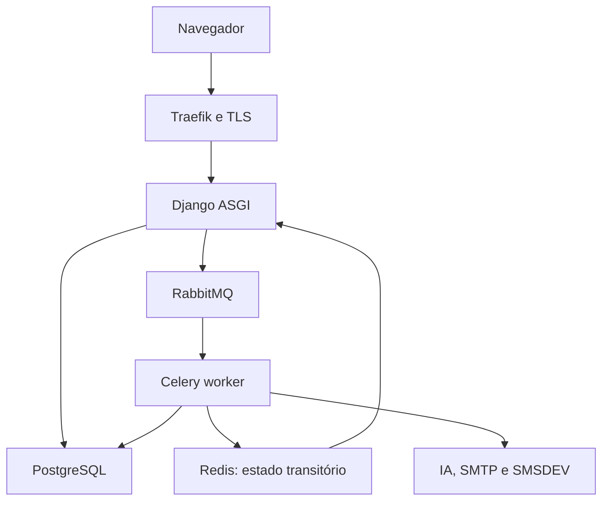

# NeuroDoc — Documentação técnica

Esta documentação é publicada em `/technical-docs/` e protegida por MFA para
administração técnica (`ops/docs.py`). Não é o produto clínico nem substitui o
PRD; é a referência operacional viva gerada a partir dele.

## Fundação (S01)

- [Decisões, limites e responsáveis pendentes](decisions.md) — DEC-01 a
  DEC-20 e P-01 a P-10 com dono e condição de liberação.
- [Design system — inventário de tokens e componentes](design-system.md) —
  catalogado a partir do arquivo real em `design_system/design-system.html`.
- [Baseline de ambiente, imagens e versões](operations/environment.md) —
  topologia, capacidade e matriz de versões propostas.
- [Inventário de permissões e superfícies de acesso](security/access-surfaces.md) —
  admin, jobs, anexos, exports, cache e SSE.

## Identidade, tenants e auditoria (S02)

- [Homologação M0](homologation/M0.md) — evidências de H-02/H-03/H-19 básicos
  e H-21 técnico com dados sintéticos.

## Onboarding, pacientes e catálogos (S03)

- [Homologação de onboarding e pacientes](homologation/patients.md) —
  evidências de H-01, H-04 e H-05 com dados sintéticos, incluindo verificação
  por teclado e viewport móvel.
- [Fotografia do paciente](homologation/patient-photo.md) — retrato no
  cadastro, na ficha e no cabeçalho do atendimento; envio de arquivo e
  captura pela câmera, consentimento colhido em papel, e dois defeitos
  reais encontrados ao montar a tela (`enctype` ausente e `.avatar-text`
  anulando o tamanho da imagem).
- [Cadastro de paciente — layout, CPF, CEP e plano](homologation/patient-registration.md) —
  formulário reorganizado em seções, CPF obrigatório e conferido, base local
  de CEP dos Correios e bloco de plano de saúde; inclui um bug real de datas
  que apagava valores ao editar.

- [Busca de códigos — CID-10 e TUSS](homologation/code-search.md) — uma tela,
  duas abas; espelho da TUSS alimentado pelo worker, e por que a consulta ao
  vivo não funcionaria em produção.

- [Central de ajuda: manual e perguntas de uso](homologation/help-center.md) —
  doze processos com 25 capturas das telas reais, público e ligado à página
  inicial; o roteiro impede que o manual aponte para imagem que não existe.

## Planos e oferta comercial

- [Especificação: planos, limites, convites e página de vendas](specs/2026-09-12-planos-e-limites.md) —
  as dez decisões, com a alternativa recusada e o motivo.
- [Planos e limites](homologation/plan-limits.md) — quatro planos, override
  por clínica, e a trava valendo nas seis portas por onde paciente e médico
  entram. Rebaixar congela: nada some.
- [A IA segue o plano contratado](homologation/ia-por-plano.md) — o apoio
  clínico por IA é do Completo e do Personalizado; o bloqueio em duas
  camadas, e por que o corte é por plano e não por cota.
- [Convites com plano e console comercial](homologation/plan-invitations.md) —
  o código de convite carrega o plano contratado; o console ganha emissão de
  convite e troca de plano, as duas únicas escritas que ele tem.

## Agenda e trabalho da secretaria (S04)

- [Homologação de agenda](homologation/scheduling.md) — evidências de H-12.

## Prontuário e exame neurológico (S05)

- [Homologação de prontuário](homologation/clinical.md) — evidências de H-06/H-07.
- [Roteiro de exame estruturado](homologation/exam-templates.md) — motor de
  roteiro em árvore (387 nós carregados de YAML), roteiro de neurologia do
  `docs/reference/roteiro-exame-neurologico.pdf`, personalização por médico
  e tela do exame por eixo. Etapa 1 de 3.
- [Escalas funcionais](homologation/exam-scales.md) — 14 escalas com
  pontuação, faixas de interpretação e itens em média (SARA); painel para
  aplicá-las no atendimento. Etapa 2 de 3.

## Anexos privados e processamento local (S06)

- [Homologação de anexos](homologation/attachments.md) — evidências de H-10,
  incluindo detecção real de malware via ClamAV e correção de um bug de
  configuração (base de definições nunca era lida do volume persistente).

## Documentos médicos e assinatura (S07)

- [Homologação de assinatura](homologation/signing.md) — evidências de H-08
  com certificado PFX autoassinado sintético (P-05 em aberto), incluindo
  assinatura PAdES real via pyHanko e validação independente.

## Comunicações, outbox e notificações (S08)

- [Homologação de comunicações](homologation/communications.md) — evidências
  de H-09: dispatcher outbox idempotente, entrega por e-mail/SMS, link
  opaco com OTP e reconciliação (P-03 em aberto para credenciais reais).

## CRM e financeiro (S09)

- [Homologação de CRM e financeiro](homologation/management.md) — evidências
  de H-13/H-14: kanban administrativo sem dado clínico, integração com a
  agenda por evento explícito, tabelas de preço com vigência sem
  sobreposição e conciliação de recebíveis/pagamentos/ajustes em Decimal.

## IA com autorização e revisão médica (S11)

- [Homologação de IA](homologation/ai.md) — evidências de H-17: autorização
  revalidada no worker, tools com escopo/paginação, desidentificação e
  política de privacidade fail-closed, schema Pydantic rejeitando saída
  inválida/probabilidade numérica, e um bug real corrigido no dispatcher de
  outbox (só suportava um consumidor por tópico). P-06/P-09 em aberto.

- [Provedor de IA padrão da instalação](homologation/ai-installation-default.md) —
  o padrão da instalação passa a alcançar os dez provedores do catálogo, e
  não três; NVIDIA NIM com Nemotron como padrão desta instalação, sem
  atropelar a clínica que configurou a sua.

- [Chat de apoio — prompt, prontuário e layout](homologation/chatbot.md) —
  o chat passa a mandar instrução de sistema, prontuário do paciente da sessão
  e histórico, desidentificados, num layout de duas colunas. Quatro lacunas
  encontradas no que existia.

## Chat persistente e streaming (S12)

- [Homologação de chat](homologation/chat.md) — evidências de H-18: sessões
  isoladas sem herança de contexto, streaming real via Redis Streams e SSE
  verificado através do Traefik real, reconexão por Last-Event-ID,
  cancelamento, sanitização de Markdown e revogação interrompendo uma
  leitura já aberta.

## Prescrição e catálogo de medicamentos

- [Prescrição: catálogo da CMED, emissão avulsa e o QR](homologation/prescricao-cmed.md) —
  26 mil apresentações da Anvisa no autocomplete das três telas, com a tarja
  avisando (e não decidindo) sobre controle especial; documento emitido a
  partir da ficha do paciente, sem atendimento; emissão em papel para
  assinar à caneta; e o QR passando a sair só em documento assinado
  digitalmente. Inclui os dois roteiros que estavam quebrados e foram
  consertados.

## Atendimento em texto livre

- [Atendimento em texto livre, ao lado do estruturado](homologation/atendimento-texto-livre.md) —
  o médico escolhe, ao abrir o atendimento, entre o prontuário estruturado e
  uma página só com o texto da consulta. Medicação, hipóteses (CID) e conduta
  continuam campos estruturados nos dois tipos — é o que faz conduta e
  impressões serem copiadas de um tipo para o outro nos dois sentidos. Os
  dois podem ser abertos num dia e finalizados em outro, e a grade traz
  abertura e fechamento como colunas que ordenam. Homologado com
  `checks/check_texto_livre.py` (13 seções). Traz também a ficha do paciente
  com **todos** os atendimentos — tipo, abertura, fechamento, rolagem e
  ordenação pelas duas datas — e o contato (celular e e-mail) no cadastro do
  paciente, que vira `PatientContact` na mesma transação. Inclui os cinco
  defeitos que a construção produziu — o formulário aninhado, o resumo cheio
  de seções vazias, o corpo da consulta fora do hash de integridade, a porta
  que ficou sem a escolha e o `instance.pk` que é verdadeiro antes de gravar
  — e o roteiro alheio que o resíduo do novo derrubou.

## Mensagens internas da equipe

- [Mensagens da equipe](homologation/mensagens-equipe.md) — janela flutuante
  ao lado do sino, arrastável e redimensionável, com presença real e entrega
  ao vivo por Redis Streams e SSE. As sete decisões com a alternativa
  recusada, e o que a implementação deliberadamente **não** decide
  (retenção e expurgo continuam com quem responde pela LGPD na clínica).
  Homologado na pilha local com `checks/check_mensagens.py` e `curl -N`
  pelo Traefik real; inclui os três defeitos encontrados ao homologar —
  o stream que reentregava histórico numa conexão nova, as duas asserções
  erradas do próprio roteiro, e o 403 de CSRF que se anunciava como
  "organização suspensa".

## Aderência ao celular

- [Aderência ao celular](homologation/mobile.md) — auditoria em navegador de
  verdade: 30 telas em quatro tamanhos, incluindo celular deitado e tablet.
  Nenhuma transbordava, mas os campos renderizavam a 13,5px e o Safari do
  iPhone dava zoom na página a cada toque — mais de mil campos no prontuário
  estruturado. Inclui o erro de usar largura em vez de `pointer: coarse`
  (celular deitado tem 844px), os dois transbordos reais entre 768px e 900px,
  e por que `checks/check_mobile.py` existe: as regras não produzem efeito
  nenhum no computador, e CSS invisível é o primeiro a ser apagado.

## Homologação final e documentação (S14)

- [Aceite final v1](homologation/v1.md) — rastreabilidade, pendências
  explícitas e liberação de funcionalidades elegíveis.
- [Aderência visual](homologation/design-adherence.md) — tokens reais do
  design system aplicados a todo o produto; achados reais de navegação
  corrigidos (seleção de organização, redirecionamento após deep link).
- [Aplicação integral do design system](homologation/design-system-full.md) —
  o tema Duralux real (CSS, JS, shell, botões, sombras, animações)
  aplicado às 51 telas, servido localmente sem requisição externa;
  nove defeitos reais encontrados e corrigidos, incluindo dois do próprio
  tema.
- [Acessibilidade](homologation/accessibility.md) — teclado, foco, rótulos
  e viewport móvel verificados com navegador real.
- [Desempenho e índices](homologation/performance.md) — medição na escala
  local disponível; RNF-01.01 na escala-alvo permanece pendente.
- [Revisão de isolamento](homologation/isolation.md) — admin, exportações,
  chat, tasks, download e cache revisados novamente.
- [Retenção, chaves e incidentes](governance/incident-response.md) —
  consolidação final de governança operacional.

## Relatórios (S13)

- [Homologação original de relatórios](homologation/reports-capture.md) —
  evidências de H-15/H-16: indicadores conferidos com totais
  sintéticos conhecidos, CSV protegido contra injeção de fórmula,
  exportação síncrona/assíncrona com expiração de 24h. A captura local
  descrita no registro histórico foi retirada do produto em 29/09/2026.

## Operação e piloto assistencial (S10)

- [Versionamento do produto](operations/versionamento.md) — versão exibida
  na interface, diferença para o SHA da release e regra de incremento a
  partir da próxima atualização funcional (v1.1).
- [Homologação M2](homologation/M2.md) — gate de marco (H-08/H-09/H-13/H-14/
  H-21/H-22 e revisão de H-03) com duas clínicas fictícias; P-02/P-05/P-06/
  P-07/P-10 permanecem pendentes e explicitamente bloqueiam o piloto real.
- [Deploy](operations/deploy.md), [rollback](operations/rollback.md),
  [backup e restauração](operations/restore.md) e
  [monitoramento](operations/monitoring.md) — mecanismos verificados sem VPS
  real (P-02), incluindo o roundtrip criptográfico do `age` e a correção de
  três bugs reais no comando `prepare_recovery`.
- [Inventário de governança/LGPD](governance/inventory.md) — categorias de
  dado e retenção implementadas; liberação por responsáveis reais depende
  de P-06/P-07.

## Arquitetura

Monólito modular Django (`core` configura, `base` compartilha primitivas, apps
de domínio na raiz), PostgreSQL como fonte de verdade clínica, Celery para
trabalho pesado e SSR com Django Templates. Sete serviços permanentes: `app`,
`celery_worker`, `celery_beat`, `db`, `rabbitmq`, `redis`, `traefik`.

Nenhuma suíte de testes automatizados existe neste projeto (DEC-20); esta
documentação, a verificação sintática e a homologação manual (seção 21 do PRD)
substituem uma suíte automatizada.
