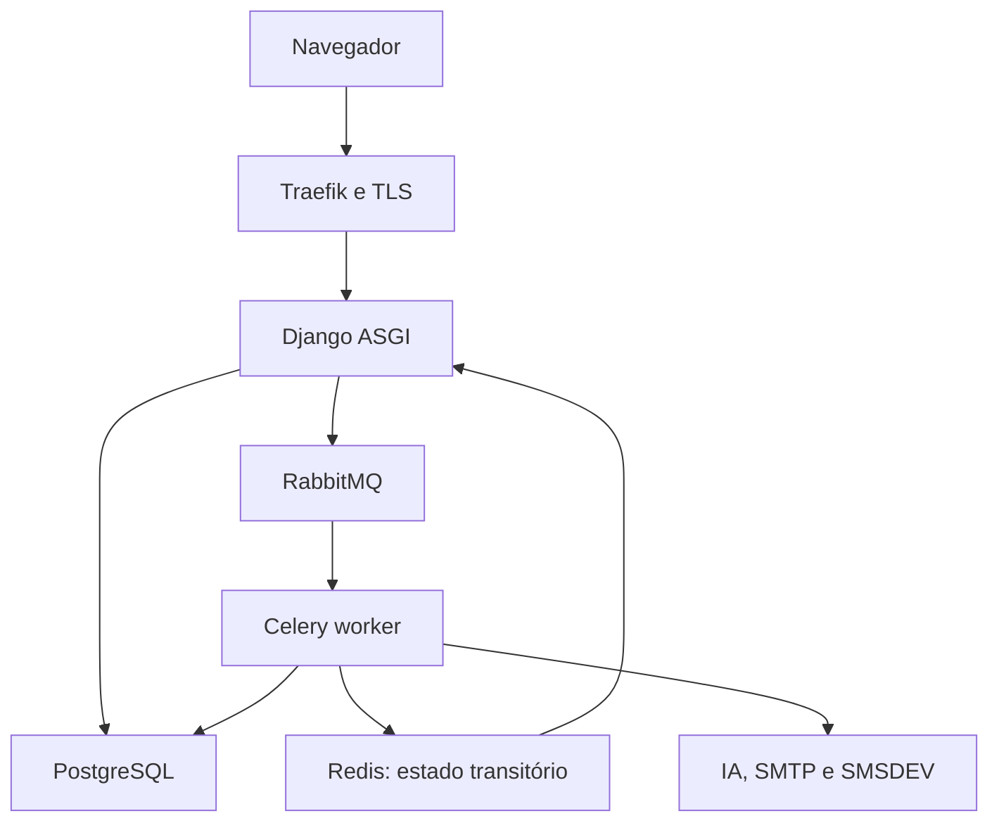

# NeuroDoc — Documentação técnica

Esta documentação é publicada em `/technical-docs/` e protegida por MFA para
administração técnica (`ops/docs.py`). Não é o produto clínico nem substitui o
PRD; é a referência operacional viva gerada a partir dele.

## Fundação (S01)

- [Decisões, limites e responsáveis pendentes](decisions.md) — DEC-01 a
  DEC-20 e P-01 a P-10 com dono e condição de liberação.
- [Design system — inventário de tokens e componentes](design-system.md) —
  catalogado a partir do arquivo real em `design_system/design-system.html`.
- [Baseline de ambiente, imagens e versões](operations/environment.md) —
  topologia, capacidade e matriz de versões propostas.
- [Inventário de permissões e superfícies de acesso](security/access-surfaces.md) —
  admin, jobs, anexos, exports, cache e SSE.

## Identidade, tenants e auditoria (S02)

- [Homologação M0](homologation/M0.md) — evidências de H-02/H-03/H-19 básicos
  e H-21 técnico com dados sintéticos.

## Onboarding, pacientes e catálogos (S03)

- [Homologação de onboarding e pacientes](homologation/patients.md) —
  evidências de H-01, H-04 e H-05 com dados sintéticos, incluindo verificação
  por teclado e viewport móvel.

## Agenda e trabalho da secretaria (S04)

- [Homologação de agenda](homologation/scheduling.md) — evidências de H-12.

## Arquitetura

Monólito modular Django (`core` configura, `base` compartilha primitivas, apps
de domínio na raiz), PostgreSQL como fonte de verdade clínica, Celery para
trabalho pesado e SSR com Django Templates. Sete serviços permanentes: `app`,
`celery_worker`, `celery_beat`, `db`, `rabbitmq`, `redis`, `traefik`.

Nenhuma suíte de testes automatizados existe neste projeto (DEC-20); esta
documentação, a verificação sintática e a homologação manual (seção 21 do PRD)
substituem uma suíte automatizada.
