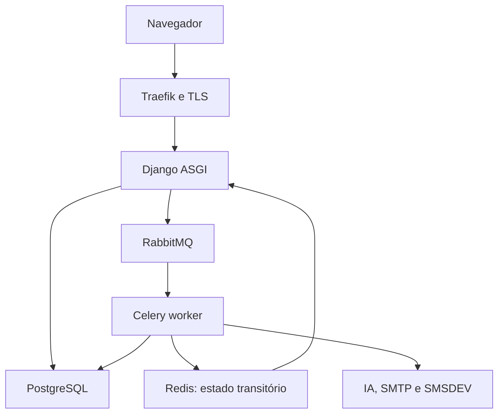

# NeuroDoc — Documentação técnica

Esta documentação é publicada em `/technical-docs/` e protegida por MFA para
administração técnica (`ops/docs.py`). Não é o produto clínico nem substitui o
PRD; é a referência operacional viva gerada a partir dele.

## Fundação (S01)

- [Decisões, limites e responsáveis pendentes](decisions.md) — DEC-01 a
  DEC-20 e P-01 a P-10 com dono e condição de liberação.
- [Design system — inventário de tokens e componentes](design-system.md) —
  catalogado a partir do arquivo real em `design_system/design-system.html`.
- [Baseline de ambiente, imagens e versões](operations/environment.md) —
  topologia, capacidade e matriz de versões propostas.
- [Inventário de permissões e superfícies de acesso](security/access-surfaces.md) —
  admin, jobs, anexos, exports, cache e SSE.

## Identidade, tenants e auditoria (S02)

- [Homologação M0](homologation/M0.md) — evidências de H-02/H-03/H-19 básicos
  e H-21 técnico com dados sintéticos.

## Onboarding, pacientes e catálogos (S03)

- [Homologação de onboarding e pacientes](homologation/patients.md) —
  evidências de H-01, H-04 e H-05 com dados sintéticos, incluindo verificação
  por teclado e viewport móvel.

## Agenda e trabalho da secretaria (S04)

- [Homologação de agenda](homologation/scheduling.md) — evidências de H-12.

## Prontuário e exame neurológico (S05)

- [Homologação de prontuário](homologation/clinical.md) — evidências de H-06/H-07.

## Anexos privados e processamento local (S06)

- [Homologação de anexos](homologation/attachments.md) — evidências de H-10,
  incluindo detecção real de malware via ClamAV e correção de um bug de
  configuração (base de definições nunca era lida do volume persistente).

## Documentos médicos e assinatura (S07)

- [Homologação de assinatura](homologation/signing.md) — evidências de H-08
  com certificado PFX autoassinado sintético (P-05 em aberto), incluindo
  assinatura PAdES real via pyHanko e validação independente.

## Comunicações, outbox e notificações (S08)

- [Homologação de comunicações](homologation/communications.md) — evidências
  de H-09: dispatcher outbox idempotente, entrega por e-mail/SMS, link
  opaco com OTP e reconciliação (P-03 em aberto para credenciais reais).

## CRM e financeiro (S09)

- [Homologação de CRM e financeiro](homologation/management.md) — evidências
  de H-13/H-14: kanban administrativo sem dado clínico, integração com a
  agenda por evento explícito, tabelas de preço com vigência sem
  sobreposição e conciliação de recebíveis/pagamentos/ajustes em Decimal.

## IA com autorização e revisão médica (S11)

- [Homologação de IA](homologation/ai.md) — evidências de H-17: autorização
  revalidada no worker, tools com escopo/paginação, desidentificação e
  política de privacidade fail-closed, schema Pydantic rejeitando saída
  inválida/probabilidade numérica, e um bug real corrigido no dispatcher de
  outbox (só suportava um consumidor por tópico). P-06/P-09 em aberto.

## Chat persistente e streaming (S12)

- [Homologação de chat](homologation/chat.md) — evidências de H-18: sessões
  isoladas sem herança de contexto, streaming real via Redis Streams e SSE
  verificado através do Traefik real, reconexão por Last-Event-ID,
  cancelamento, sanitização de Markdown e revogação interrompendo uma
  leitura já aberta.

## Relatórios e captura local (S13)

- [Homologação de relatórios e captura](homologation/reports-capture.md) —
  evidências de H-11/H-15/H-16: indicadores conferidos com totais
  sintéticos conhecidos, CSV protegido contra injeção de fórmula,
  exportação síncrona/assíncrona com expiração de 24h, e pareamento/sessão/
  recepção de lote do scanner (P-08 em aberto para o hardware real).

## Operação e piloto assistencial (S10)

- [Homologação M2](homologation/M2.md) — gate de marco (H-08/H-09/H-13/H-14/
  H-21/H-22 e revisão de H-03) com duas clínicas fictícias; P-02/P-05/P-06/
  P-07/P-10 permanecem pendentes e explicitamente bloqueiam o piloto real.
- [Deploy](operations/deploy.md), [rollback](operations/rollback.md),
  [backup e restauração](operations/restore.md) e
  [monitoramento](operations/monitoring.md) — mecanismos verificados sem VPS
  real (P-02), incluindo o roundtrip criptográfico do `age` e a correção de
  três bugs reais no comando `prepare_recovery`.
- [Inventário de governança/LGPD](governance/inventory.md) — categorias de
  dado e retenção implementadas; liberação por responsáveis reais depende
  de P-06/P-07.

## Arquitetura

Monólito modular Django (`core` configura, `base` compartilha primitivas, apps
de domínio na raiz), PostgreSQL como fonte de verdade clínica, Celery para
trabalho pesado e SSR com Django Templates. Sete serviços permanentes: `app`,
`celery_worker`, `celery_beat`, `db`, `rabbitmq`, `redis`, `traefik`.

Nenhuma suíte de testes automatizados existe neste projeto (DEC-20); esta
documentação, a verificação sintática e a homologação manual (seção 21 do PRD)
substituem uma suíte automatizada.
